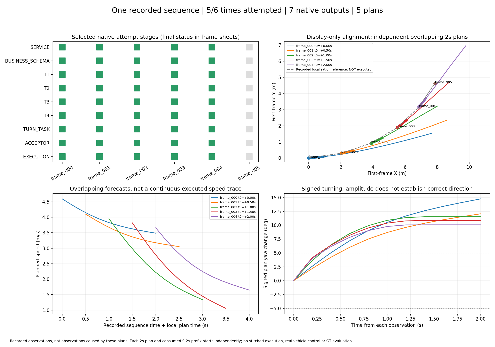

# 正式API连续转弯场景：六时刻结果

**5个时刻完成真实图像→在线模型→T1→T2→CasADi/IPOPT T3→独立T4→接受器→模拟0.2秒移动转弯前缀；最后1个时刻在非生成预检时断连，未发送模型请求。** 所有组均ended=true并停止，没有补造第六帧。

[交互索引](index.html) / [逐帧动画](sequence.gif) / [七页PDF](casebook.pdf) / [总表CSV](sequence_summary.csv) / [完整机器结果与所有失败历史](sequence_summary.json)



|时刻/逐帧证据|结果；生成尝试含失败|0.2秒位移(m)|末速(m/s)|2秒计划/已消费前缀转角(°)|最小条件间距(m)|
|---|---|---:|---:|---:|---:|
|[+0.0s frame_000](frame_000/result.json)|一次工具反馈修订通过；2次|0.902|4.406|14.76 / 2.62|3.648|
|[+0.5s frame_001](frame_001/result.json)|两次连接失败保留，恢复组一次语义修订通过；共4次|0.803|3.920|12.06 / 2.21|2.774|
|[+1.0s frame_002](frame_002/result.json)|初答通过；1次|0.754|3.547|11.54 / 3.62|1.007|
|[+1.5s frame_003](frame_003/result.json)|初答通过；1次|0.725|3.383|10.87 / 4.15|2.070|
|[+2.0s frame_004](frame_004/result.json)|初答通过；1次|0.701|3.299|10.08 / 4.03|2.286|
|[+2.5s frame_005](frame_005/result.json)|MODELS_PREFLIGHT连接失败；生成0次|—|—|NOT_REACHED|—|

前五个都是MOVING_PREFIX，T1–T4、转弯幅度检查、独立接受器与执行回执均通过；不是把原始ego移动或JSON生成当成执行。图中绿色粗段是各自实际模拟消费的0.2秒，长尾是未执行计划。最小间距已扣模型残差，并保留原1米安全间距；不确定范围不是校准误差保证。

固定scene-0916（325cef682f064c55a255f2625c533b75），6个原始采集参考相隔0.5秒，覆盖2.5秒。每个时刻独立读取其自身2秒历史10图、标定与采集ego状态；不向模型提供后续帧、地图或GT。六窗口高度相关，是一个场景，不能当六个独立样本或据此宣布数据集成功率提高。

每个规划从当时真实记录的ego状态重新开始。灰色虚线仅是用于展示的原始定位参考；不同颜色是独立、重叠的2秒预测，不能拼成反事实执行后的连续行驶。原图点/线是标定加展示性z=0投影，不是检测或真实深度。所有通过均以模型声明的局部道路、身体尺度、运动条件及全部保留情景覆盖为前提；没有G2、真实车辆安全或完整弯道通过结论。

## 连接与全部调用账本

正式服务为https://api.openai.com/v1/responses，请求和服务返回模型均为gpt-6.1-sol；独立服务快照未知。使用用户指定私有文件读取的API凭据，0600权限，未提交密钥/Authorization头；非ChatGPT订阅额度。

生成请求尝试合计11次：文本/10图诊断2次，加驾驶POST尝试9次；其中驾驶原生业务JSON7份、生成请求连接失败2次。两次失败的服务端处理和usage不可见，不推断其内部计算次数。最后frame005仅/models预检失败，额外生成0次，单独列出。每次请求均无自动重试，失败不被恢复组覆盖。

|组别|驾驶POST尝试|有效原生JSON|实际结束|
|---|---:|---:|---|
|[原API组](../openai_bend_sequence_20261029_v1/README.md)|3|2|frame000通过，frame001连接失败停止|
|[显式恢复组](../openai_bend_sequence_recovery_20261029_v1/README.md)|1|0|frame001连接失败停止|
|[同连接预检组](../openai_bend_sequence_tls_20261029_v1/README.md)|5|5|frame001–004通过，frame005预检连接失败停止|

曾在无认证同路径检查中重现SSL UNEXPECTED_EOF_WHILE_READING；其他检查又返回HTTP401，说明TLS/代理/上游路径间歇失效，具体根因仍未确认。最小接入改动为显式验证SSLContext，以及每时刻在同client单次认证GET/models后复用连接；零重试、验证证书保持。该组4次预检HTTP200、最后1次ConnectError，不能宣称切换API消除了网络问题。

## 软件与复现

业务Schema3.0.0-exp2、wire v2、driving_prototype_v3、whole_interval_sources_v3_exp2、2s/.2s网格及前缀、bounded_seed_candidates_v2均固定。T1–T4、车辆参数、模型残差处理和1米间距未修改。初答frame000被T2的目标CENTER区域边界转换拒绝，frame001被T1条件前提作用域拒绝；均由原模型收到具体反馈后修订，工具不补道路/占用/数值。

API接入源码9b177ee；同连接预检源码357e1e6、注册ed4f00d；最终展示源码e949aa0。源码/config/SHA及原生输出/每阶段/回执在上述三个组的plan、runtime/config及transport目录。旧Codex批次与所有旧结果原样保留，不继承余额。

[最终417项离线回归](../openai_bend_sequence_tls_20261029_v1/offline_verification/unittest.txt)全通过、60.374秒、0真实调用；[测试来源](../openai_bend_sequence_tls_20261029_v1/offline_verification/provenance.json)。[frame000真实输出零调用复算](../openai_bend_sequence_tls_20261029_v1/offline_replay_frame000/summary.json)已实际通过，位移和末速与在线记录一致，不计新增在线成功。

下面只读取已保存真实输出，生成全新目录，不读取密钥或调用模型：

```bash
cd /data2/hzy/MAP/agentic-driving
OUT="$(mktemp -d /tmp/api-bend-replay.XXXXXX)/run"
BASE=implementation/results/openai_bend_sequence_20261029_v1
OPENBLAS_NUM_THREADS=1 OMP_NUM_THREADS=1 .venv/bin/python implementation/experiments/run_local_prototype.py \
  --capture implementation/results/continuous_bend_20261029_v1/inputs/frame_000/capture.json \
  --wire implementation/results/exp2_wire_enum_day_pilot_20261028_v1/registration/wire_bundle \
  --replay "$BASE/runtime/frame_000/attempt_02/record.json" \
  --planner-profile bounded_seed_candidates_v2 --require-turn --out "$OUT"
python implementation/experiments/prototype_figure.py --run "$OUT" --out "$OUT/result.png"
```

最具体的剩余卡点是最后时刻生成前的连接失败。当前不改场景、物理标准或换模型来绕过，也不自动继续发起恢复组。
