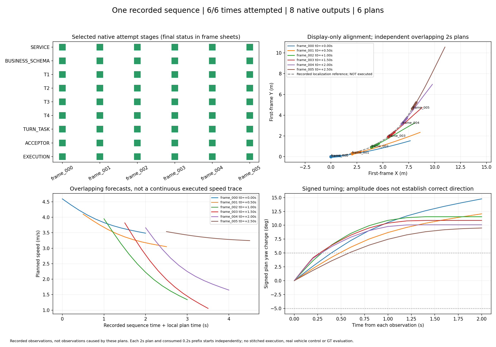

# 连续转弯六时刻：frame005补齐后的结果

**六个固定时刻现均已完成过真实模型→T1–T4→独立接受器→模拟0.2秒移动转弯前缀。** 本轮仅补跑frame005，一次真实生成通过，前五帧复用原通过证据；旧失败与v2报告保持原样。

[动画](sequence.gif) / [PDF](casebook.pdf) / [逐帧索引](index.html) / [CSV](sequence_summary.csv) / [完整历史与计数](sequence_summary.json) / [本次frame005详情](../frame005_recovery_20261029_v1/README.md)



|时刻/逐帧证据|结果|全部生成尝试含失败|0.2秒位移(m)|末速(m/s)|计划/前缀转角(°)|最小条件间距(m)|
|---|---|---:|---:|---:|---:|---:|
|[+0.0s frame_000](frame_000/result.json)|工具反馈修订通过|2|0.902|4.406|14.76 / 2.62|3.648|
|[+0.5s frame_001](frame_001/result.json)|含两次连接失败，恢复组语义修订通过|4|0.803|3.920|12.06 / 2.21|2.774|
|[+1.0s frame_002](frame_002/result.json)|首次生成通过|1|0.754|3.547|11.54 / 3.62|1.007|
|[+1.5s frame_003](frame_003/result.json)|首次生成通过|1|0.725|3.383|10.87 / 4.15|2.070|
|[+2.0s frame_004](frame_004/result.json)|首次生成通过|1|0.701|3.299|10.08 / 4.03|2.286|
|[+2.5s frame_005](frame_005/result.json)|旧预检失败保留，本轮首次生成通过|1|0.704|3.490|9.51 / 1.86|3.258|

本轮新增生成请求1次，无重试/修订；驾驶各组累计10次POST尝试、8份有效业务JSON、2次生成请求连接失败，另保留1次非生成预检失败。加上先前2次短接入诊断，累计生成请求尝试12次。重跑不增加唯一窗口分母：仍为scene-0916的6个相隔0.5秒的记录时刻、1个场景，不能由此推断正式成功率。

前五帧的原始JSON、轨迹和执行回执未改。唯一运行变化是frame005在网络恢复后使用相同API配置补跑；T1–T4、Schema、提示、模型、车辆、残差、安全间距与2秒配置均保持。先前预检失败和本次成功分别记录，状态为FIRST_GENERATION_PASS_AFTER_PREFLIGHT_FAILURE。

绿色短段为各时刻各自已模拟消费的0.2秒，长尾为未执行计划。不同帧仍从原始采集ego状态独立规划，统一坐标仅用于展示；后续原始图像不是执行新计划后的反事实观测。这些是模型局部场景及运动条件成立时的链路通过，没有G2或真车安全结论。

模型接入曾发生间歇连接失败，永久网络根因未确认；本轮不修改规划参数来处理连接问题。原[v2五帧结果](../api_continuous_bend_20261029_v2/README.md)及全部组均保留。新结果/source SHA及旧失败史见机器汇总，每个时刻只有一份被选中的通过记录。

零模型调用复现frame005（输出必须为新目录）：

```bash
cd /data2/hzy/MAP/agentic-driving
OUT="$(mktemp -d /tmp/frame005-replay.XXXXXX)/run"
OPENBLAS_NUM_THREADS=1 OMP_NUM_THREADS=1 .venv/bin/python implementation/experiments/run_local_prototype.py \
  --capture implementation/results/continuous_bend_20261029_v1/inputs/frame_005/capture.json \
  --wire implementation/results/exp2_wire_enum_day_pilot_20261028_v1/registration/wire_bundle \
  --replay implementation/results/frame005_recovery_20261029_v1/runtime/frame_005/attempt_01/record.json \
  --planner-profile bounded_seed_candidates_v2 --require-turn --out "$OUT"
python implementation/experiments/prototype_figure.py --run "$OUT" --out "$OUT/result.png"
```

本次补跑已结束，未追加其他窗口或调用。
