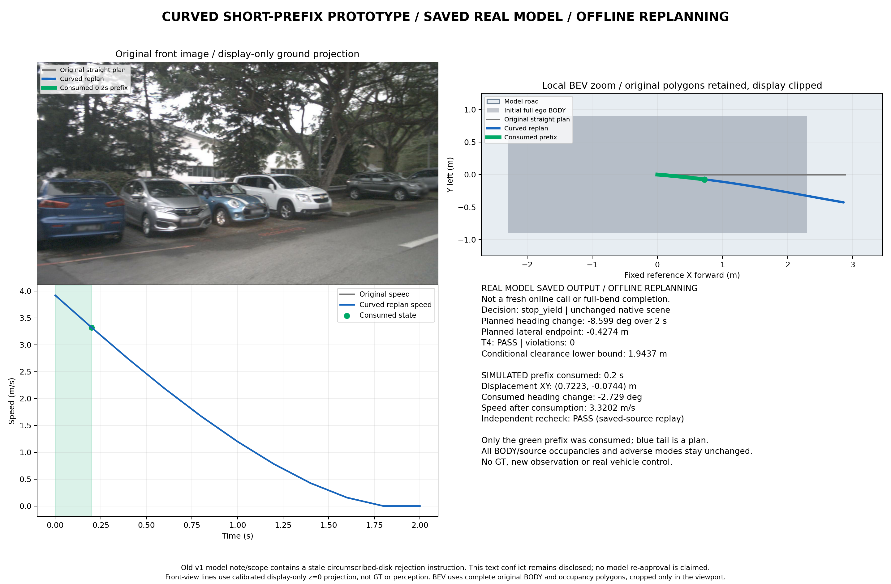

# 弯道验证：真实新窗停止，保存真实输出完成曲线重规划

**已产生并核验明显右转轨迹，实际模拟消费了转向前缀；来源是旧真实模型输出的零调用重规划。新选“已入弯”在线试验没有通过：初答T1拒绝，修订连接中断后按约定停止，预算2/4。** 两类结果分别报告，不将离线或人工结果计作新在线弯道成功。



## 曲线实际效果与最小优化

复用上一轮邻车窗口`a19a80c905674faab7203a3a4e0f5246`的[真实原记录](../scene_expansion_20261029_v1/runtime/neighbor_bend/attempt_02/record.json)，没有修改模型道路、目标区域、对象、BODY、情景、残差、停车让行决策或1米间距。

发现并修复的具体问题：原流程先按最低代价选择候选，再检查是否转弯，因而选中直线，错过了已经通过T4的曲线。新增**可选任务筛选**：每个候选先独立通过T4，再检查预登记任务，最后在任务合格者中取最低代价。默认不启用时旧行为保持。没有扩大几何、增加预测或放松任何物理约束。

|实际结果|数值|
|---|---|
|选中候选|`brake_right`，原有五候选之一|
|2秒计划末航向/横移|**−8.598591° / −0.427409m**|
|实际模拟消费|**0.2秒**，MOVING_PREFIX|
|消费航向变化|**−2.728521°**|
|消费位移XY / 距离|**[0.722332, −0.074359]m / 0.726149m**|
|消费末速度|**3.320203m/s**|
|T4 / 独立接受器 / 回执积分|全部通过，违例0|
|条件间距下界|**1.943695m**，仍要求1m|

这是`stop_yield`决策下的**带转向制动**，计划随后停稳，未走完整个弯道。前向相机近处盲区使短轨迹投影不在原图视野内，未假造可见线；BEV按等比例放大展示，模型占用原样保留，仅显示视口裁剪。

[实际全链结果](offline_curve_replay/round_result.json)、[逐候选账本](offline_curve_replay/attempt_01/candidate_ledger.json)、[T4](offline_curve_replay/attempt_01/T4.json)、[任务测量](offline_curve_replay/attempt_01/turn_task.json)、[消费回执](offline_curve_replay/attempt_01/execution_receipt.json)均可复查。[新旧对照](analysis/offline_comparison.json)确认T1/模型输出不变，选中的T2/T3/T4与此前保存的同一候选逐值相同；改善来自选择规则，而非模型重新生成几何。

旧模型v1文本仍含过时圆盘拒绝指令，这一文义冲突保留，**不称模型重新认可执行**。接受器内部旧状态名带ONLINE只反映来源检查，公开结果为保存真实输出离线重规划；实际`fresh_online_model_call=false`。未取得执行新轨迹后的图像，不将录像后续帧当作反事实观测；不是G2或真实车辆安全结论。

## 新选已入弯窗口的实际在线结果

选窗仅用五张允许采集表、参考时刻之前的自车历史及原图。固定左弯`9cdbf5ff7f294549aea0a4307e5d104a`、右弯`c1eed31234b94e9f8e22fbf3428b0ac2`，均scene-0916，**2窗口、1scene**。初速分别3.661、4.242m/s；过去2秒航向变化+42.352°/−36.148°仅用于选窗，不是未来轨迹目标。原2秒/.2秒、10图、车辆/1米间距不变，只导航意图明确要求有图像依据的转弯任务。[注册](plan.json)/[输入与SHA](input_registration.json)/[候选预览](candidate_preview.png)保留，未按模型结果换窗。

|窗口/尝试|实际返回|后续阶段|
|---|---|---|
|左弯初答|真实原生JSON通过业务Schema；T1 BODY_ENVELOPE_CONFLICT|T2–T4、任务检查、执行、接受器全部NOT_REACHED|
|左弯针对修订|连接错误，无原生JSON|全部NOT_REACHED；失败计预算，立即停止|
|右弯|NOT_ATTEMPTED|未评价，不计失败|

初答的[具体拒绝](runtime/left_entered/attempt_01/T1-failure.json)为`silver_parked_sedan / silver_body_0_2 / silver_stationary`：旋转BODY两角超出原包络，最大约**0.001165m**。未放宽名义车身覆盖检查、吸收进残差或改写模型包络。[原JSON](runtime/left_entered/transport/attempt_01/native_output.json)及反馈均保留。

修订收到`responseStreamDisconnected / Connection failed: error sending request`，HTTP状态未知，**不是已证实429或额度耗尽**。服务通知willRetry=true，适配器首次错误立即终止，无额外turn/start。[实际预算](batch_summary.json)2/4，余2不继续使用、不转移；没有尝试右窗或换账号/模型绕过错误。一次前置rateLimits元数据读取显示34%、未耗尽，仅metadata，无生成，不保证服务可用。使用既有ChatGPT登录、17891代理、固定CLI0.164.0，请求/解析别名gpt-6.1-sol；服务端快照未知。

## 任务判据与回归

预登记仅用于识别明显转弯：2秒计划最大航向变化≥5°、横移≥.3m；精确积分的.2秒前缀航向变化≥.1°、位移>.01m。这不是安全阈值或G2标准，不授权任意摆头。必须先满足模型道路/决策/全部物理约束和独立T4，再满足任务，才模拟消费；直行/静止不能冒充弯道演示。登记bundle名`turn_evidence_v1`，实现评估器名`visible_turn_description_v1`，数值与冻结源码一致，没有事后调门槛。

[404项完整回归](verification/unittest.txt)全部通过、0跳过，55.158s；[来源](verification/provenance.json)记录禁止网络连接、实际模型调用0。新增4项人工真实IPOPT测试覆盖曲线/直线区分、已有合格曲线候选被选中、全部任务失败时T4仍PASS但执行器不创建、默认选择兼容。人工测试不增加在线分子。

在线冻结源码`d7212d5`；候选任务筛选改动`5f79996`；图与全量回归`a9ff20c`。在线结束后才改候选筛选，不能归因为新在线效果。[公有运行清单](analysis/runtime_public_manifest.json)不含现场私有账号/raw流；全部原结果保留。初版`offline_curve_result.png`仅排版draft，正式图为本文v2。图的210个显示积分点与原积分器逐值一致，见[图核对](figure_checks.json)。

**当前最具体的未完成项仍是新入弯窗口的原生包络修订及真实全链验证；修订请求被服务中断阻止。** 本轮停止外呼，不重发旧请求或使用余量。没有新在线过弯成功、完整弯道完成或真实世界准确性结论。

## 零调用复现曲线

输出必须是新目录。使用保存真实响应，重新完成T1–T4、任务筛选、接受器和模拟消费：

```bash
cd /data2/hzy/MAP/agentic-driving
BASE=implementation/results/scene_expansion_20261029_v1
OUT="$(mktemp -d /tmp/driving-curve-replay.XXXXXX)/run"
OPENBLAS_NUM_THREADS=1 OMP_NUM_THREADS=1 .venv/bin/python \
  implementation/experiments/run_local_prototype.py \
  --capture implementation/results/six_scene_scout_preparation_20261029_v1/prepared_inputs/main/neighbor_bend/capture.json \
  --wire implementation/results/exp2_wire_enum_day_pilot_20261028_v1/registration/wire_bundle \
  --replay "$BASE/runtime/neighbor_bend/attempt_02/record.json" \
  --planner-profile bounded_seed_candidates_v2 --require-turn --out "$OUT"
python implementation/experiments/bend_result_figure.py --run "$OUT" --out "$OUT/curve.png"
```

不要重跑已结束真实launcher重置预算；上述复现不读取未来帧、GT或调用模型。
