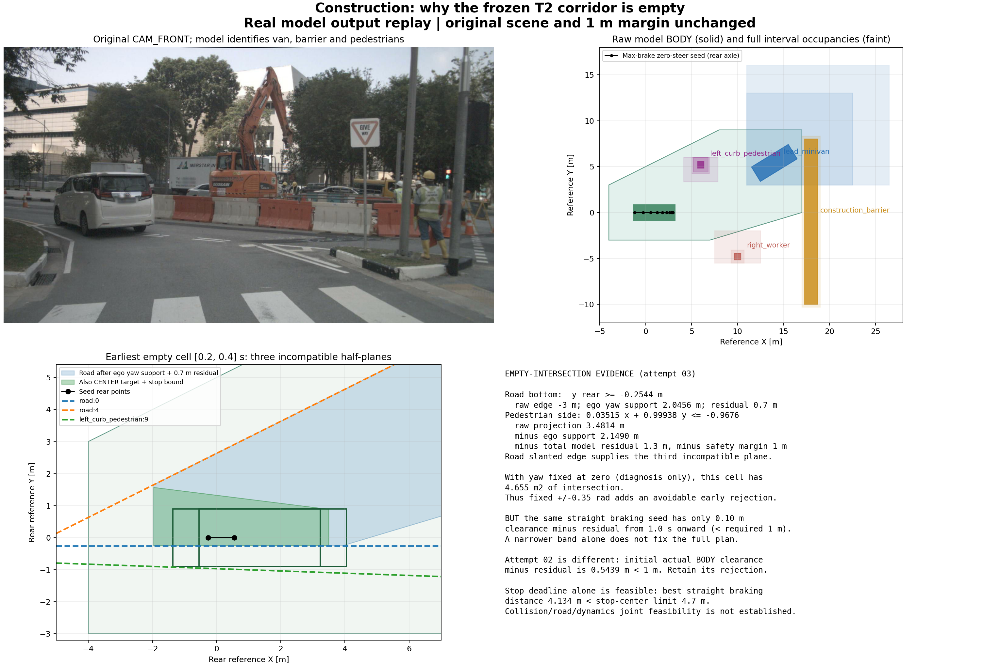

# 施工走廊改进：两轮离线迭代与受控新调用

**完成两轮最小算法改进。公交、停车场固定真实输出仍能完成轨迹核验及0.2秒移动前缀消费；施工从T2空走廊推进到两条候选进入T3，但求解均不可行，没有释放轨迹。** 新真实请求用量 **2/4**：一份有效原生输出，一次连接服务故障；已停止外呼，红灯 **NOT_ATTEMPTED**，剩余2次不继续使用。



## 定位到的问题

旧施工第三份输出在 **[0.2,0.4]s** 的空交集由道路下边界、道路斜上边界和左侧行人不利占用共同造成。道路下边界原为−3m，车身在±0.35rad内的竖直支持量2.0456m，再计道路残差0.7m，要求后轴Y≥−0.2544m。行人分离面同时扣除车身支持2.1490m、模型总残差1.3m和原1m安全间距。三个半平面的非负组合推出 `0 ≤ −0.237615m`：[逐约束与源占用](diagnosis/diagnosis.json)、[不可行证书](diagnosis/empty_witness_certificate.json)。这是真实约束冲突，不能靠看原图判断有解。

固定航向为零时，仅该单元有4.655m²交集，证明原航向包络存在早期保守性；这只是诊断，不作为执行规则。直行满制动种子在后续行人不利包络下条件间距仅0.10m，仍小于1m。另一份旧施工输出在初态的真实矩形车身条件间距已经只有0.5439m，继续拒绝。停车截止自身并不矛盾：初速4.98065m/s、最大制动3m/s²，理想制动时间约1.660s、距离4.134m，分别小于原1.9s截止与4.7m位置上界；道路、碰撞、转向联合可行性仍未建立。

## 保留的最小改进

1. 显式 `bounded_seed_candidates_v1` 尝试至多5个确定性参考：原种子、强制动直行、制动小幅右转/左转/较强右转。均从实际后轴状态出发，满足原加速度、转角、曲率限制。有限搜索耗尽不代表全局无解。
2. 新候选采用每段参考航向范围外扩0.025rad、再与原±0.35rad相交的闭航向带。T2使用完整车身解析支持函数，T3施加相同端点硬界，T4独立检查同一航向带；常曲率及非负速度使段内航向单调。原车辆、全部目标BODY/情景/残差、道路和1m间距保持。旧默认及旧Schema字节不改；两个小型衍生Schema仅显式承载该搜索标识与航向带。
3. 第二轮允许参考种子作为初始化提示，而不要求它自己已经落在整条走廊内。真实初态、单元连通、T3全约束及独立T4仍必需。T3采用对应参考的状态和控制初始化；所有求解结果交给T4，只有通过者可消费。未修改连续碰撞包络，没有提前投入T4细分或求解器调参。

| 固定输出比较 | 第一轮 | 第二轮/最终结果 | 模拟消费与末速 |
|---|---|---|---|
| 公交 `7ff999a1`，旧在线成功JSON | 2/5候选T4通过 | 2/5候选T4通过；接受器通过 | MOVING_PREFIX，1.271865m，6.320778m/s |
| 停车场 `8573a885`，旧在线失败JSON | 2/5到T2，1条T4通过 | 4/5到T2，1条T4通过；保留原可行解 | MOVING_PREFIX，1.032550m，5.110593m/s |
| 施工 `88449a5c`，旧第三份JSON | 原候选[0.2,0.4]空；窄带候选可推进至约0.8s | 2/5到T2；两次IPOPT均 `Infeasible_Problem_Detected`；T4 NOT_REACHED | 无前缀 |

公交/停车场本轮均是**真实模型输出离线重规划**，不能重新记成新增在线成功。完整[逐轮对照表](comparison/comparison.md)及[机器结果](comparison/comparison.json)保留所有候选、失败、平顺性与12组T1逐值不变对照。公交最终条件间距下界4.4611m、停车场2.2979m；公交旧圆盘下界1.7472m采用不同保守包络，数值变化不是实测真实安全改善。最大加速度约0.3855/0.5216m/s²，离散加速度差分jerk代理约0.1610/0.2178m/s³；分段常加速度控制存在跳变，代理不能称为连续RMS jerk。

[公交四面板图](final_replays/bus/result.png) / [停车场四面板图](final_replays/parking/result.png) / [施工失败图](final_replays/construction/result.png)。人工窄路及“制动提示不安全但优化后向前可行”的反例单列为软件回归，不计真实分子。

## 实际新调用与停止

调用前通过官方固定CLI的 `account/rateLimits/read` 读取到当前窗口使用19%、未标记耗尽，元数据请求不生成模型输出：[额度记录](quota_preflight/result.json)。这不保证具体模型权益或排除短时故障。

施工原10图及采集参数保留，左前相机补充2秒内两帧，共12图；没有未来帧、GT、地图或其他感知模型。请求固定 `gpt-6.1-sol`，实际服务端模型快照仍未暴露。模型根据历史细分了工人的整区间占用，保留全部四个对象、残差和不利情景，没有移开障碍或扩大路面：[原生初答](live_construction/transport/attempt_01/native_output.json)、[实际输入](live_construction/transport/attempt_01/model_input.txt)。新增历史仍不足以支持排除行人迈入及工人向路面移动的条件，模型原文见 `hypotheses.confidence_note`；它关于旧圆盘的解释不是当前规划器诊断结论。

| 请求/记录 | 服务与原生输出 | T1/T2/T3/T4 | 消费 |
|---|---|---|---|
| 新施工初答，扣账1 | 完成；原业务Schema PASS | T1 PASS；第一轮搜索T2失败；T3/T4 NOT_REACHED | 无 |
| 新施工针对性修订，扣账1 | `responseStreamDisconnected`，HTTP未知，`willRetry=true`；适配器首次错误即终止 | 无原生JSON，业务校验与工具均NOT_REACHED | 无 |
| 红灯标签窗口 | NOT_ATTEMPTED，因前例服务错误停止批次 | NOT_REACHED | 无 |
| 同份新初答，零调用最终回放 | 原生记录复用 | 2条T2通过，T3不可行，T4 NOT_REACHED | 无 |

客户端未追加turn/start或传输重试；内部HTTP重连次数不可见，不能宣称为零。本次错误不是已确认429。原始修订台账的SERVICE=NOT_REACHED保留；请求已扣账并收到错误通知，不能据该旧字段解释成未发送。[批次账本](batch_result.json)、[在线汇总](live_construction/summary.json)、[新JSON旧规划器回放](live_output_old_planner/summary.json)及[最终新规划器回放](final_replays/live_construction/summary.json)分别保存。未继承旧批次剩余额度、未换账号或模型、未重置预算。

## 关键对象的轻量独立对照

以下均为历史知情、非盲事后视觉匹配；GT只在离线评价进程，不进入模型或工具。位置对照为参考时刻注释中心合法插值，未来为有向注释车身插值surrogate，并非真实连续占用；保留全部模型情景与原总残差一次膨胀。

| 对象 | 中心差m | 长/宽差m | 未来surrogate覆盖 / 面积膨胀 |
|---|---:|---|---|
| 停车场近侧Mercedes | 3.156 | 0.174 / 0.256 | 0.00255 / 3.748倍 |
| 停车场Nissan | 2.323 | 0.417 / 0.246 | 0.41778 / 4.227倍 |
| 施工前车 | 0.923 | 0.027 / 0.057 | 1.0 / 27.712倍 |
| 施工左侧行人 | 0.215 | 0.061 / 0.010 | 1.0 / 72.734倍 |
| 施工近处工人 | 2.433 | 0.137 / 0.075 | 1.0 / 67.510倍 |

停车场的条件规划通过没有证明场景准确；左行人当前位置较准确，但未来包络非常宽。高覆盖不能证明可靠预测，也不能用GT删除模型不利分支。详见[原两窗对象对照](critical_actor_evaluation/README.md)及[实际阻塞对象](critical_actor_evaluation/blocking_actor_review/README.md)。聚合隔离设施无法匹配单体框；公交为模型单个BODY、GT铰接车分段标注，均不评分：[公交粒度限制](critical_actor_evaluation/bus/README.md)。全部匹配/缺失、尺寸/朝向差和不评分原因在各机器报告中，未形成G2 PASS或成功率结论。

## 代码、验证与零调用复现

原默认/Schema/提示/T1和历史结果保留。第一轮算法代码`16ee9bc`；在线注册与实际启动HEAD `32adc43`；第二轮最终算法`7a6159c`。前两次开发回放存在未提交改动，记录的HEAD不冒称完整源码冻结；`final_replays/*/config.json`记录最终实际源码SHA与dirty状态。最终回放核心字节与`7a6159c`一致，后续提交只补辅助脚本、测试及交付。

针对性8项回归见[日志](seed_candidate_targeted_tests.txt)，覆盖航向带/控制限制、窄路求解、提示不必是解、篡改拒绝及未来侵入拒绝。[最终369项回归](final_offline_regression.txt)全部通过、0跳过，36.263s；这些人工测试不计在线分子。初次368项回归保留在offline_regression.txt，不累计成独立测试。[源码核对与现场说明](source_and_validation_notes.json)确认最终回放源码SHA均与7a6159c一致；原注册与CLI兜底deadline的差异原样披露，批次在较早注册截止前已停止。

以下仅回放，必须使用新输出目录：

```bash
cd /data2/hzy/MAP/agentic-driving
BASE=implementation/results/varied_prototypes_2s_20261028_v1
OUT="$(mktemp -d /tmp/construction-candidates.XXXXXX)/run"
OPENBLAS_NUM_THREADS=1 OMP_NUM_THREADS=1 \
  .venv/bin/python implementation/experiments/run_local_prototype.py \
  --capture "$BASE/construction_yield/capture.json" \
  --wire implementation/results/exp2_wire_enum_day_pilot_20261028_v1/registration/wire_bundle \
  --replay "$BASE/construction_yield/runtime/attempt_03/record.json" \
  --planner-profile bounded_seed_candidates_v1 --out "$OUT"
# 施工当前预期退出3；候选与不可行证据仍保存在OUT，不表示程序崩溃。
python implementation/experiments/prototype_figure.py --run "$OUT" --out "$OUT/result.png"

# 停车场移动前缀：将上面capture/replay中的construction_yield改为parking_bend，attempt_03改为attempt_02。
OPENBLAS_NUM_THREADS=1 OMP_NUM_THREADS=1 \
  NUSCENES_CASES_DIR="$PWD/runs/nuscenes_cases_20261027" \
  .venv/bin/python -m unittest discover -s implementation/tests -v
```

**最具体的剩余问题：** 施工模型声明的行人/工人不利整区间包络下，目前仅两条连通凸走廊进入优化器且均不可行；尚未找到满足实际初速、停车截止、道路及1米间距的轨迹。这不是全局无解证明。本轮不靠缩小未知、删情景或降低安全要求求通过；已停止外呼与迭代，不执行真实车辆控制。
