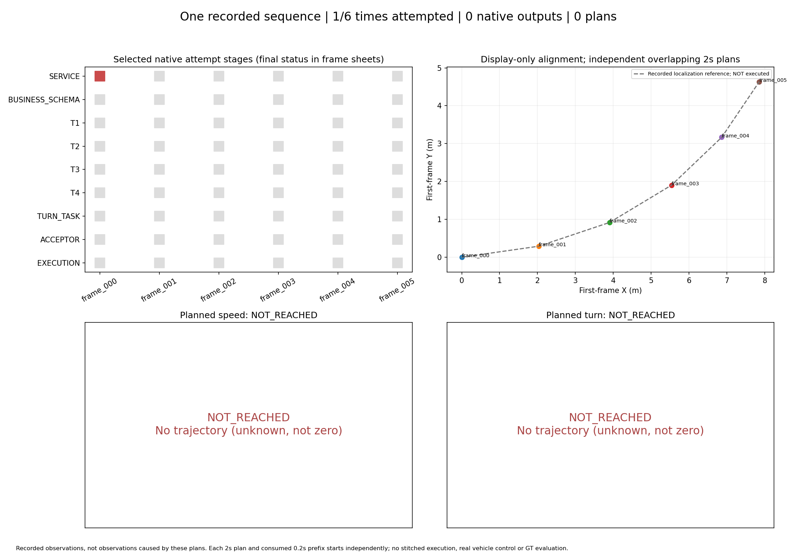

# 连续转弯片段：逐帧回放与实际中断结果

**本轮未取得连续模型输出：首帧真实请求连接失败，按约定在1/12次扣账后停止，其余5帧未调用；原生输出、规划轨迹和模拟消费均为0。** 已生成固定六时刻的逐帧结果文件、图片、动画、PDF和整段汇总，全部明确区分服务失败与未调用。这些是原始采集片段及中断状态的展示，不能称为连续驾驶链路已经跑通。

- [交互式完整报告](analysis_final/index.html)
- [逐帧动画](analysis_final/sequence.gif) / [完整PDF](analysis_final/casebook.pdf)
- [六帧拼图](analysis_final/contactsheet.png) / [时间轴与统一坐标总览](analysis_final/sequence_overview.png)
- [机器汇总](analysis_final/sequence_summary.json) / [CSV](analysis_final/sequence_summary.csv)



## 固定片段和每帧结果

场景为nuScenes scene-0916，固定最后6个连续关键帧参考时刻，间隔.5秒、总跨度2.5秒。每个时刻独立使用截止其参考时刻的2秒历史、10张原图、自车与标定数据；预测2秒，网格/前缀.2秒，原车辆及1米间距不变。不是对完整高帧率视频的每张图都调用模型。

|帧/相对时刻|样本前8位|原录像自车速度m/s|原录像相对首帧航向|本轮模型/工具状态|单帧结果|
|---|---|---:|---:|---|---|
|000 / 0.0s|a1289b27|4.594|0°|服务错误，无原生输出；T1–T4/任务/执行NOT_REACHED|[JSON](analysis_final/frame_000/result.json) / [图](analysis_final/frame_000/result.png)|
|001 / .5s|e6e877f3|4.101|+7.814°|NOT_ATTEMPTED|[JSON](analysis_final/frame_001/result.json) / [图](analysis_final/frame_001/result.png)|
|002 / 1.0s|cb4e6195|3.952|+18.135°|NOT_ATTEMPTED|[JSON](analysis_final/frame_002/result.json) / [图](analysis_final/frame_002/result.png)|
|003 / 1.5s|7f594234|3.819|+30.272°|NOT_ATTEMPTED|[JSON](analysis_final/frame_003/result.json) / [图](analysis_final/frame_003/result.png)|
|004 / 2.0s|9cdbf5ff|3.661|+42.352°|NOT_ATTEMPTED|[JSON](analysis_final/frame_004/result.json) / [图](analysis_final/frame_004/result.png)|
|005 / 2.5s|b4ff3010|3.537|+54.022°|NOT_ATTEMPTED|[JSON](analysis_final/frame_005/result.json) / [图](analysis_final/frame_005/result.png)|

原图中，车辆沿树岛和护栏继续向左，银色停放车逐渐退出右侧视野；采集定位显示持续左转并减速。这是助手离线视觉审阅和**原录像采集状态**，不是模型检测、米制道路真值或规划结果。[原录像运动说明](recorded_motion_analysis.json)保留来源与数值。

统一坐标图仅用各capture中**精确共同的过去采集记录**逐帧链式变换，1.2m中心偏移已在导出计入，不再加一次。灰虚线是原录像定位参考；绝不是优化器输出或模拟执行路径。即使后续取得全部计划，也只可叠加不同起始时刻的独立2秒计划，不可把前缀拼成闭环执行。原始后帧不能当作执行新轨迹后的观测。

输入只读取sample、sample_data、ego_pose、sensor、calibrated_sensor五表，无地图、actor注释、未来帧或其他感知模型进入运行时。选段预览过整段原图，不称盲测。六个强重叠窗口来自1个scene，不作六个独立样本或数据集成功率统计。

## 实际停止原因与预算

[冻结运行计划](plan.json)使用用户新独立授权：最多12次、45分钟、每时刻初答及至多一次工具反馈修订、串行、失败计预算、无旧余额继承。实际[批次账本](batch_summary.json)为ended=true、扣账1、余11未继续使用；[请求核对](runtime_integrity.json)恰1个turn/start。

首帧收到`responseStreamDisconnected`、`Connection failed: error sending request`，[原始失败](runtime/frame_000/attempt_01/failure.json)及净化RPC事件保留。HTTP状态未知，不能追称429、额度耗尽、Schema错误或模型缺少场景信息。通知willRetry=true，适配器首次错误即终止，没有额外turn/start；服务内部HTTP尝试数不可见。

一次元数据rateLimits读取返回使用36%、未标记耗尽，但不能保证生成服务可用。实际接入为固定官方CLI0.164.0、现有ChatGPT登录、17891代理、请求/解析别名gpt-6.1-sol，服务端生成快照未知。私有账号/raw流留现场忽略目录，不发布令牌。服务错误后未再外呼、未换账号/模型、未将剩余许可移到新目录重置。

本轮没有模型决策或对象数量分母，位置/速度/未来覆盖等模型指标均不可评，不填零、不造G2分数。所有图中空计划区明确写unknown/not zero。当前卡点是**真实生成连接**，本次根本没有到达T1–T4，不能拿这些未调用帧评价工具成功率。

## 实现与验证

本组提示显式为`driving_prototype_v3`，在旧v2上增加两条已有契约自检：名义BODY必须完整包住并保守外舍入；异步对齐前提覆盖真实负时间区间。没有修改业务3.0.0-exp2、wire、未知表达或T1拒绝条件，不能用残差代替欠包络。默认旧提示保留。**本轮无原生响应，所以新提示在线效果完全未验证。**

复用现有模型接入、T1–T4、五候选规划器及转弯任务检查；仅新增连续片段启动器和只读汇总。源码/输入在 **`c3b5d6b20c183755e4adc7e15b020aacadd4ff1c`** 冻结。每帧总是需要模型参与，不使用CALL/SKIP；服务停止后的NOT_ATTEMPTED只是中断状态。

[406项离线回归](verification/unittest.txt)全部通过、0跳过，55.331s；[来源](verification/provenance.json)记录网络连接禁止和真实调用0。新增2项v3测试证明实际mock载荷/旧默认、BODY欠包络/null/缺负时间仍拒绝。汇总另有2项明确人工的坐标/缺结果自检，不当作在线验证或相加为408项。

初版`analysis/`保留为展示草稿；**正式文件是`analysis_final/`**，已改成实际尝试/输出计数，无计划时去掉数值轴并写NOT_REACHED。该展示修正未改runtime或统计，实际输入/错误/停止记录均原样保留。

## 零调用复现汇总

必须使用新的输出目录；该命令只读现存记录，不调用模型、不刷新本报告：

```bash
cd /data2/hzy/MAP/agentic-driving
OUT="$(mktemp -d /tmp/bend-sequence-report.XXXXXX)/report"
python implementation/experiments/summarize_bend_sequence.py \
  --plan implementation/results/continuous_bend_20261029_v1/plan.json \
  --out "$OUT"
```

不要重跑真实launcher重置本轮额度。恢复生成连接后仍须使用这六个固定时刻、保留本次中断结果，另行登记执行；不更换帧来隐藏失败。本轮没有连续模型分析完成或连续转弯执行成功结论。
