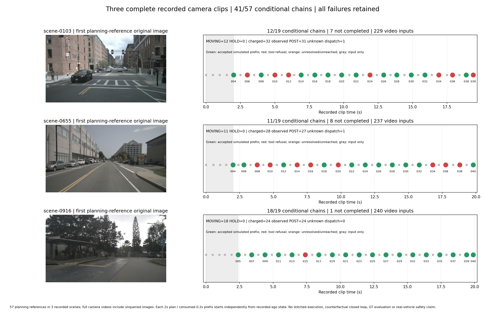

# 三场景完整相机clip：结果总览

3个scene、57个规划参考时刻，条件式链路通过41个；未完成16个，失败全部保留。



|场景|原片/稠密图像|条件通过/19|未完成|移动/静止|扣账/已观察POST/派发未知|
|---|---|---:|---:|---|---|
|[scene-0103](following_deceleration/index.html)|19.40s / 229|12|7|12/0|32/31/1|
|[scene-0655](bus_road/index.html)|19.80s / 237|11|8|11/0|28/27/1|
|[scene-0916](parking_bend/index.html)|19.90s / 240|18|1|18/0|24/24/0|

累计扣账84、已观察POST 82、派发未知2；先前非生成预检失败1次。未知在途请求及observer closure保留，不能据此说模型返回失败。

完整相机视频包含706张原始前向图，模型只在57个选定参考时刻决策；每次规划2秒、模拟消费0.2秒，未查询图像没有新计划。每时刻从录制ego独立回放，不是反事实闭环、GT或真车安全证明。

零模型调用复现（使用全新输出目录）：

```bash
cd /data2/hzy/MAP/agentic-driving
OUT="$(mktemp -d /tmp/long-clips-report.XXXXXX)"
python implementation/experiments/summarize_long_clip.py --plan /data2/hzy/MAP/agentic-driving/implementation/results/long_clips_20261029_v1/following_deceleration/plan.json --additional-plan /data2/hzy/MAP/agentic-driving/implementation/results/long_clips_20261029_v2/following_deceleration/plan.json --additional-plan /data2/hzy/MAP/agentic-driving/implementation/results/long_clips_20261029_v3/following_deceleration/plan.json --dense-front-index /data2/hzy/MAP/agentic-driving/implementation/results/long_clips_visual_20261029_v1/dense_front_inputs.json --dense-video-only --out "$OUT/following_deceleration"
python implementation/experiments/summarize_long_clip.py --plan /data2/hzy/MAP/agentic-driving/implementation/results/long_clips_20261029_v1/bus_road/plan.json --additional-plan /data2/hzy/MAP/agentic-driving/implementation/results/long_clips_20261029_v2/bus_road/plan.json --additional-plan /data2/hzy/MAP/agentic-driving/implementation/results/long_clips_20261029_v3/bus_road/plan.json --dense-front-index /data2/hzy/MAP/agentic-driving/implementation/results/long_clips_visual_20261029_v1/dense_front_inputs.json --dense-video-only --out "$OUT/bus_road"
python implementation/experiments/summarize_long_clip.py --plan /data2/hzy/MAP/agentic-driving/implementation/results/long_clips_20261029_v1/parking_bend/plan.json --additional-plan /data2/hzy/MAP/agentic-driving/implementation/results/long_clips_20261029_v2/parking_bend/plan.json --additional-plan /data2/hzy/MAP/agentic-driving/implementation/results/long_clips_20261029_v3/parking_bend/plan.json --dense-front-index /data2/hzy/MAP/agentic-driving/implementation/results/long_clips_visual_20261029_v1/dense_front_inputs.json --dense-video-only --out "$OUT/parking_bend"
python /data2/hzy/MAP/agentic-driving/implementation/results/long_clips_visual_20261029_v1/make_overview.py --root "$OUT"
```
