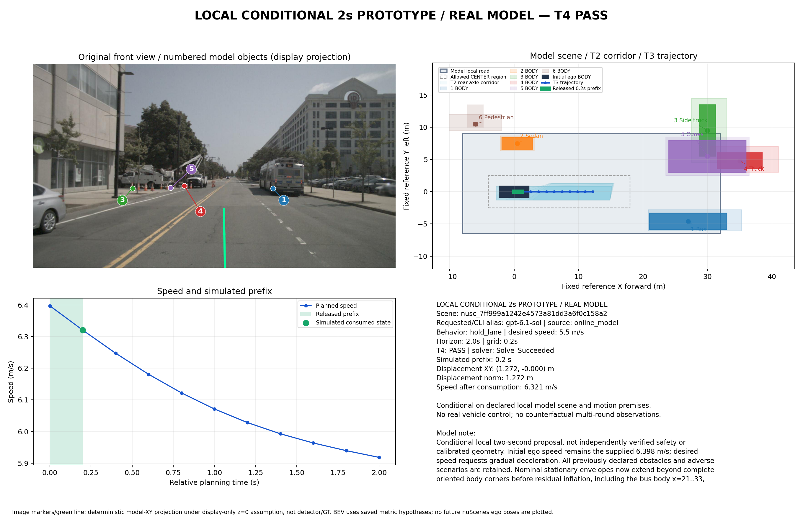

# 真实图像单窗口：2秒局部条件驾驶原型

**已实际跑通：真实图像 → 在线模型 → T1米制场景 → T2走廊 → T3约束优化 → T4核验 → 模拟消费0.2秒移动前缀。** 使用本轮2/4次真实请求后停止，剩余2次不继续调用。第一份输出保留失败，第二份由同一模型修订后通过全部环节；没有人工填写道路、占用或轨迹。



## 实际效果

| 项目 | 实测结果 |
|---|---|
| 原始窗口 | nuScenes `7ff999a1242e4573a81dd3a6f0c158a2`，新案例，与旧失败窗另列 |
| 输入 | 10张原图、2秒历史、采集/标定/自车状态；无地图、目标GT或其他感知模型 |
| 初始速度 | **6.397872m/s**（采集定位的因果后向差分估计） |
| 模型决策 | `hold_lane`，期望速度5.5m/s，保持车道并平顺减速 |
| 预测/网格 | 2秒 / 0.2秒，共11个轨迹状态；原5秒基线不变 |
| 轨迹优化 | 实际CasADi 3.7.2/IPOPT，`Solve_Succeeded` |
| T4 | **PASS**，违例0，条件场景下最小间距下界约1.747m |
| 已模拟消费 | **0.2秒，前向位移1.271865m，末速6.320778m/s**；`MOVING_PREFIX` |
| 未执行的计划尾部 | 2秒位置约12.205m、速度5.918m/s；不能当成已执行位移 |
| 独立接受器 | 场景/走廊重建、独立T4、执行回执及积分均通过 |

模型估计的6个对象为公交车、银色轿车、两辆作业车、锥桶区域和人行道行人，均保留在场景与未来占用中。图中编号与BEV对应；不在前向投影视野中的对象只在BEV显示。原图绿线及标记是按标定和展示性z=0平面投影的模型坐标，不是检测框、深度真值或规划输入。

## 调用与工具证据

| 环节 | 输入 → 实际输出 |
|---|---|
| 在线模型 | [原始采集](capture.json)及新提示 → [第二次原生JSON](runtime/transport/attempt_02/native_output.json)、[完整请求文本](runtime/transport/attempt_02/model_input.txt) |
| T1 | [模型原记录](runtime/attempt_02/record.json) → [米制场景](runtime/attempt_02/T1.json) |
| T2 | T1及原车辆/安全配置 → [2秒走廊](runtime/attempt_02/T2.json) |
| T3 | T1、T2、驾驶决策 → [带时间/控制量的轨迹](runtime/attempt_02/T3.json) |
| T4 | 原场景、轨迹 → [独立核验与0.2秒释放](runtime/attempt_02/T4.json) |
| 模拟消费 | 已核验前缀 → [执行状态](runtime/attempt_02/execution.json)、[一次消费回执](runtime/attempt_02/execution_receipt.json) |
| 独立接受器 | 全链及原图SHA → [接受结果](runtime/attempt_02/acceptor.json) |

第一次真实输出已经提供道路和6个对象占用，但T1发现公交名义包络未覆盖完整初始车身，返回`BODY_ENVELOPE_CONFLICT`。实际修订将该对象/情景违例和前次原生输出反馈给模型；第二次由模型修订车身包络后通过，工具没有改写模型几何。[第一次失败](runtime/attempt_01/T1-failure.json)、[第二次阶段结果](runtime/attempt_02/stages.json)、[调用账本及汇总](runtime/summary.json)、[控制台日志](online_console.txt)均保留。实际turn/start两次，无传输重试。

模型请求及CLI别名为`gpt-6.1-sol`，真实服务端快照未暴露；使用现有ChatGPT登录。实际运行源码提交`a59e2d2`，图的排版随后独立改善，没有重跑模型。原始图像和各工具输入输出均可直接查看，不把JSON生成当成全链完成。

## 本原型与旧严格实验的边界

新提示为`driving_prototype_v1`，显式profile为`local_conditional_2s_prototype_v1`；复用3.0.0-exp2数据结构、现成wire与T1–T4。T1只对该真实提示/profile/2秒组合开放独立入口，并要求模型声明有限局部域。旧提示、5秒配置、失败、预算和默认行为不改；T2、T3、T4及车辆/碰撞/安全间距算法本轮未修改。

本次模型声明的局部域为X[-12,44]、Y[-7,16]m；采用两秒内无额外未观测进入者、停车场车辆不穿过人行道进入、远处对向车辆与后方车辆不进入该域等条件。公交车/停放车辆等使用模型给出的短时运动条件及有限不利变体，场景清单只在这些条件下完备，**不穷尽真实世界未来**。所有声明对象仍接受原来的身体、区间覆盖、碰撞、道路及运动检查。

接受器保留了旧内部键`strict_live_physical_success`，其本次含义是独立检查通过；对外交付统一用`prototype_conditional_success`，明确`old_strict_experiment_success=false`。这不是旧5秒实验通过、米制准确率/G2通过或真实车辆安全证明。

本图是**真实模型单窗口结果**。[已有人工多轮演示](../process_recovery/delivery_demo.txt)仍单独标为人工测试，不计入此案例。本次没有获取执行新轨迹后的新图像，不将nuScenes后续原始观测当作反事实执行后的观测。G2后续开展，不阻塞本交付。

## 零模型调用复现

已实际执行[离线复现](offline_replay/summary.json)：从第二份真实原生输出重新运行T1–T4、接受器和模拟前缀，位移与速度复算一致，新增模型调用0。以下命令生成新的唯一目录，不覆盖本次结果；求解使用项目`.venv`，绘图使用服务器已有`python`（matplotlib/Pillow/numpy），未更改其他项目环境。

```bash
cd /data2/hzy/MAP/agentic-driving
REPLAY_DIR="$(mktemp -d /tmp/driving-prototype-replay.XXXXXX)/run"
BASE="implementation/results/moving_prototype_2s_20261028_v1"
.venv/bin/python implementation/experiments/run_local_prototype.py \
  --capture "$BASE/capture.json" \
  --wire implementation/results/exp2_wire_enum_day_pilot_20261028_v1/registration/wire_bundle \
  --replay "$BASE/runtime/attempt_02/record.json" --out "$REPLAY_DIR"
python implementation/experiments/prototype_figure.py \
  --run "$REPLAY_DIR" --out "$REPLAY_DIR/result.png"
```

[347项回归](offline_tests.txt)通过，包括原型隔离、人工2秒移动完整链路以及已有碰撞拒绝/运动关系检查；[接入21项复测](transport_tests.txt)通过，不重复累计为新增测试。它们是软件证据，真实原型的成功证据来自上述第二次原生输出及实际工具/执行记录。[简明机器结果](result_summary.json)记录核心数值与条件。图生成出现的Fontconfig提示未阻止实际PNG输出；未以此增加环境安装或工程范围。

**当前唯一主要目标已完成，停止调用。** 不扩展六窗、正式成功率评估或真实车辆控制。
