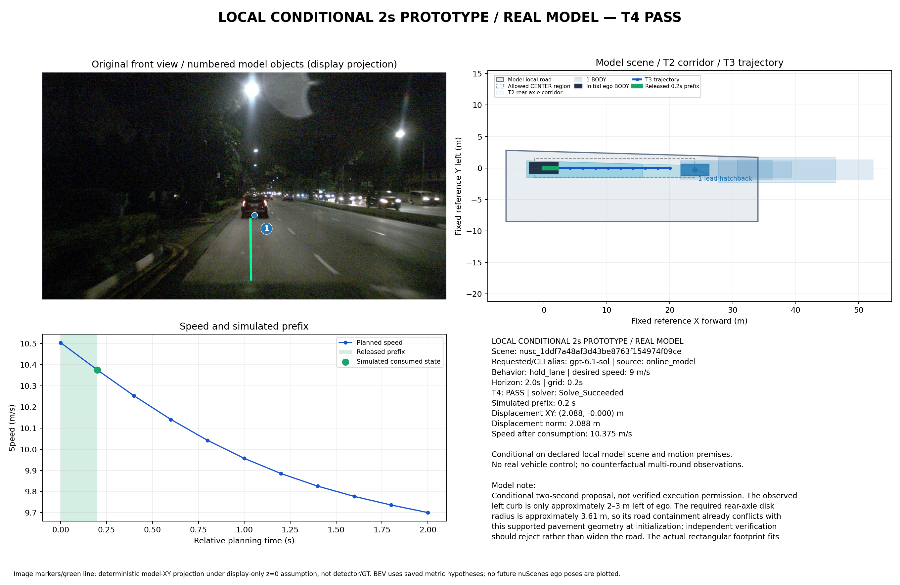
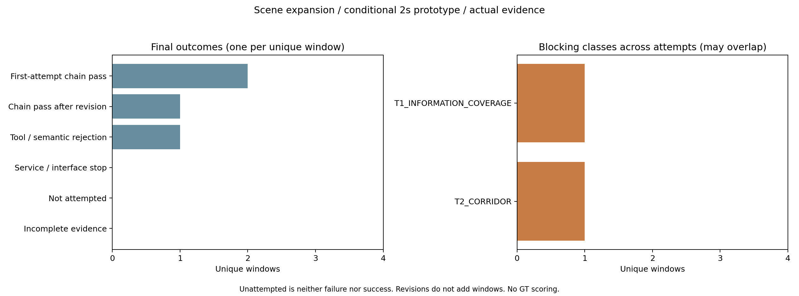

# 新四场景扩展与下一轮最小优化

**四个不同scene已实际运行，6/8次真实请求后停止，无服务错误。三窗完成T1–T4、独立接受器和0.2秒模拟移动前缀消费；夜间行人窗两次均在T2拒绝。** 其中邻车和夜间直行的模型文本仍按旧圆盘预期拒绝，存在工具说明文义冲突，不能把这两窗描述成“模型文本也认可可执行”。本轮已修正新提示版本，但没有追加真实调用验证其效果。



## 实际结果

原40张图、采集/标定/自车状态及10图组织保持；2秒预测、.2秒网格/.2秒前缀、原车辆和1米障碍间距不变。运行使用`driving_prototype_v1`、原3.0.0-exp2业务Schema/wire v2、`bounded_seed_candidates_v2`。没有地图、注释、未来帧或额外感知模型进入运行时。

|场景/样本|真实请求|首次→修订|实际消费.2s|条件间距下界|解释边界|
|---|---:|---|---|---:|---|
|邻车轻弯 0916 / `a19a80c9…`|2|T1拒绝→全工具链通过|前向.723923m，3.919452→3.319778m/s|1.418160m|制动让行，未完成过弯；模型note及scope文本仍错误要求按圆盘拒绝|
|夜间行人 1094 / `07c29094…`|2|T2空→T2仍空|NOT_REACHED|—|没有轨迹或前缀，不能写成正确静止等待|
|夜间直行 1077 / `1ddf7a48…`|1|首次全工具链通过|前向2.087883m，10.503985→10.374849m/s|3.784482m|保持车道减速；模型note仍错误预期圆盘道路拒绝|
|白天路口 0757 / `e122a34e…`|1|首次全工具链通过|前向.657098m，3.556168→3.014816m/s|3.864709m|根据模型路口/横向车流假设制动，未完成停车或验证信号真值|

三个消费均为MOVING_PREFIX。通过的T2/T3/T4候选分别为5/5/5、2/2/2、5/5/5；夜间行人0/0/0，后续均NOT_REACHED。最大绝对加速度分别约2.9984、.6457、2.7068m/s²，仍在原制动上限内。逐次服务/原生Schema/工具/接受器/回执、积分及平顺性代理见[完整机器表](summary/window_results.json)和[简表](summary/window_results.md)。这4个精选窗口和修订不构成数据集成功率或独立重复稳定性实验。



图中T1类别的实际根因是旧工具说明，不应概括为模型缺少环境信息。模型米制量、条件运动界和局部域没有独立GT验证。图上投影仅为展示用z=0；本轮未做G2，不称真实车辆安全或反事实多轮闭环。

## 已实施的两项修改

**1. 修正过时工具说明，显式新提示`driving_prototype_v2`。** 旧提示中的圆盘段与实际完整有向车身不一致，还使模型误将1米障碍间距额外加到道路。新提示仅更换版本头和工具说明段：道路检查完整BODY加道路残差；障碍分离完整BODY、总模型残差及配置间距各一次；T3硬航向带与独立连续T4保持。它没有授权扩路、删物或缩残差。旧提示原字节保留；新增`--prompt-version`显式选择，默认仍v1，在线v2提示必须配v2规划器。业务Schema、未知表达和物理标准未改。

首窗[13处原生字段差异](analysis/neighbor_revision.json)证明修订的道路、全部5个actor完整记录、BODY/未来占用/情景/残差及决策除revision外都没变。模型原生延长部分前提到负时间、删去`initial_disk_road_fit`并把担忧改写为文字；**不能将通过单独归因于删字段**。旧圆盘拒绝指令仍留在scope/note，故[独立行为审阅](analysis/behavior_review.json)明确标记两窗文本冲突，不回写接受器或原模型输出。

[新提示差异与SHA](analysis/prompt_v2_diff.json)记录仅两处替换。新提示的实际载荷、版本/规划器配对、旧默认、2秒/局部域/null拒绝边界均经离线mock测试；mock不是在线模型。**本轮六份真实响应全部来自旧提示，新提示在线收益未验证。**

**2. T2返回具体冲突，保持原拒绝。** v2的CORRIDOR_EMPTY/INITIAL_STATE现在包含对象、源/情景、时间、原BODY包络、图像引用、支持函数、模型残差、1米间距、半平面及交集清空前允许域。它是构造顺序中首先清空交集的约束，不冒称最小不可满足集或全局无解证明。成功几何、候选、T3/T4及旧v1错误均不变。

本批[行人窗的具体证据](analysis/pedestrian_initial_t2.json)：后车`following_car`的原[0,2]不利源`following_body_0_2 / following_continue`前沿至X=-2.5m，总残差1.1m。原参考候选要求后轴X≥.722154m，停车要求后轴X≤.4m，两者相差.322154m，当前交集为空。关联原始图为`c9436084f6ad4894b3a4726c07a84c97`。**这不是证明t=0真实后车撞车**：名义当前后车间距尚足，是整段未来包络与停车约束冲突。仅凭前向图看似可通行不能删除后车不利模式。

两份行人输出各5候选[零调用回放](post_batch/t2_feedback_replay/summary.json)仍全部拒绝、T1和错误码不变，仅反馈更具体。最具体的剩余工作是让同一模型依据因果后车历史检查未来占用与停车位置/时刻的一致性；不能默认移开后车、缩残差或修改IPOPT求通过。

## 对照、测试与预算

[同份原生JSON的旧圆盘/当前v2对照](post_batch/profile_comparison/summary.json)：三个通过窗在旧圆盘均拒绝，在当前有向车身v2均完成链路；行人窗两版都拒绝。这解释了旧提示冲突，**不是本轮新提示效果或新的在线成功样本**。[公交/停车场/减速旧成功回放](post_batch/existing_successes/summary.json)全部保持通过。

[400项回归](post_batch/verification/unittest.txt)全部通过、0跳过，46.209s；[来源](post_batch/verification/provenance.json)记录Python连接禁止、真实调用0，覆盖本轮5项针对测试及原有运动/碰撞/来源/预算回归。启动器[两项人工预算干跑](software_checks/launcher_budget_checks.json)分别验证4×2上限和首服务失败停止，不算真实请求。

全量测试后仅补充“错误配置不创建证据目录”的断言，[原3项提示测试复跑](post_batch/final_prompt_tests.txt)通过；运行算法未再改变，不把重复测试另加到400项。

生成配置/源码在 **`a48d5d2397bb7f171e683d82857e5c23a16b7d70`** 冻结，批中未改算法或提示。四窗均记录实际源码SHA；worktree新增结果/分析的dirty状态如实保留。[运行字节与冻结源码核对](analysis/runtime_integrity.json)、[公有runtime清单](runtime_public_manifest.json)不包含私有账号/raw流。私有目录0700/0600且Git忽略，无令牌发布。

批次结束后才接入两项修改，冻结于 **`b83a1c6d6beb5cd70080f5280c37b411978ffccb`**；失败反馈的准备回放保留dirty及实际T2 SHA，不追写成干净运行。

[授权计划](plan.json)为本任务独立最多8次/45分钟、串行、每窗最多2次、失败计预算，无旧余额继承；[实际账本](batch_summary.json)与6个turn/start一致，6份原生JSON均过原业务Schema。生成阶段无服务错误/重发；启动前一次权限审核超时未执行元数据命令，重试权限审核后唯一rateLimits读取返回使用32%、无耗尽标记，生成请求0，不是可用性保证。固定官方CLI0.164.0、现有ChatGPT登录、17891代理、请求/解析别名gpt-6.1-sol；实际服务端快照未知。

原六窗批次没有续跑或转移余额。本轮后三个旧未调用窗另列为新v2组；原预留0757在本轮已使用，不再称未来未触及holdout。四窗/40图[输入登记与预览](preparation/inputs.json)保留；夜间直行真实历史为1.900011秒，未补帧或造时间。剩余2次不继续使用，[后续单窗提案](next_trial_proposal.json)为launched=false、授权0，不继承余量。

## 零调用复现

以下从保存的真实输出回放到T4、接受器和模拟前缀，生成新目录；不会发模型请求。后续观测不存在，不能当连续执行多次前缀：

```bash
cd /data2/hzy/MAP/agentic-driving
BASE=implementation/results/scene_expansion_20261029_v1
OUT="$(mktemp -d /tmp/scene-night-replay.XXXXXX)/run"
OPENBLAS_NUM_THREADS=1 OMP_NUM_THREADS=1 .venv/bin/python \
  implementation/experiments/run_local_prototype.py \
  --capture implementation/results/six_scene_scout_preparation_20261029_v1/prepared_inputs/main/night_straight/capture.json \
  --wire implementation/results/exp2_wire_enum_day_pilot_20261028_v1/registration/wire_bundle \
  --replay "$BASE/runtime/night_straight/attempt_01/record.json" \
  --planner-profile bounded_seed_candidates_v2 --out "$OUT"
python implementation/experiments/prototype_figure.py --run "$OUT" --out "$OUT/result.png"
```

回放保留原生prompt版本，不把旧响应改标v2。新提示CLI入口已具备，但本交付不提供自动重跑已结束真实批次的命令。此轮停止于上述真实结果和离线修改。
