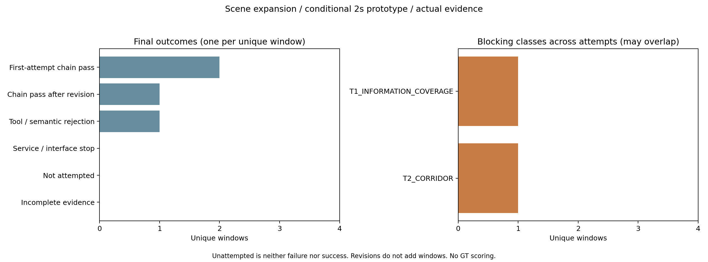

# 新四场景实际结果

固定4个不同scene；扣账6/8，观察到6个turn/start。新增模型调用0（本脚本仅统计）。

|窗口|结果|合法原生/扣账|失败阶段/原因|T2/T3/T4候选|前缀/位移m/末速m/s|条件间距m|
|---|---|---|---|---|---|---|
|neighbor_bend / scene-0916|REVISION_PASS|2/2|—|5/5/5|MOVING_PREFIX/0.724/3.320|1.418|
|pedestrian_interaction / scene-1094|TOOL_OR_SEMANTIC_FAILURE|2/2|T2 CORRIDOR_EMPTY|0/0/0|NOT_EXECUTED/—/—|—|
|night_straight / scene-1077|FIRST_ATTEMPT_PASS|1/1|—|2/2/2|MOVING_PREFIX/2.088/10.375|3.784|
|heldout_intersection / scene-0757|FIRST_ATTEMPT_PASS|1/1|—|5/5/5|MOVING_PREFIX/0.657/3.015|3.865|

修订不增加唯一窗口；未调用不算失败。全部候选、服务通知、原生Schema、T1–T4、独立接受器、前缀回执/积分及平顺性代理见JSON。
行为合理性待独立图像/决策审阅，GT未读取。静止前缀不自动代表移动任务完成。
预算核对：MATCH；若扣账多于可见turn/start，应保留服务前失败/缺失证据差异，不补造调用。
