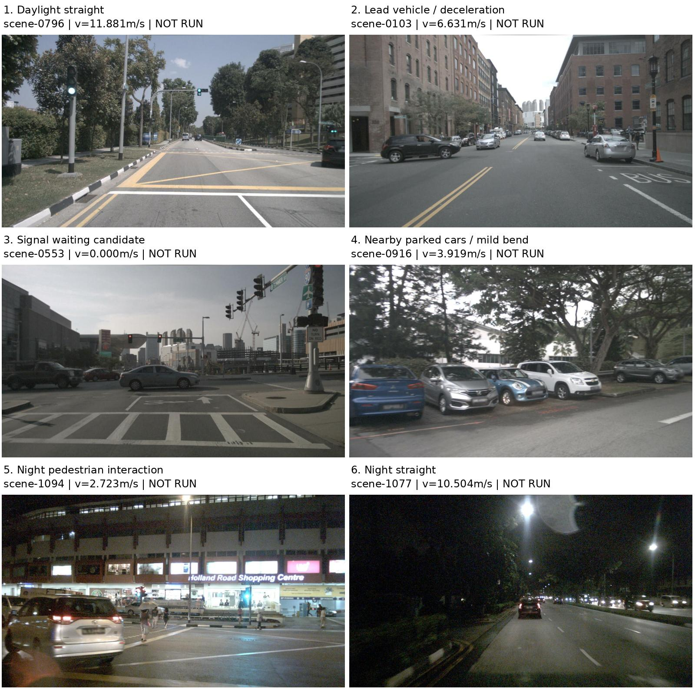

# 六场景摸底：场景、输入与运行计划

**仅完成准备；新增真实请求0、额度探针0，`launched=false`。暂停施工单例调参，本批算法、提示和物理配置未修改。** 建议新独立预算最多12次：6个不同scene，每窗初答1次、必要时最多1次工具反馈修订。目前授权调用数为0，不启用旧批次余额。



## 固定的六个窗口

|序号/类别|真实scene|sample ID|初速m/s|可见及采集依据|
|---|---|---|---:|---|
|1 普通直行|scene-0796|`7df1288fed8a403b8e7a35112b392d7c`|11.881|日间清楚直路、道路标记、远处车辆；接近原12m/s上限，不裁剪初速|
|2 有同向前车的减速候选|scene-0103|`0d0700a2284e477db876c3ee1d864668`|6.631|同向银车及侧向转出SUV；2秒历史内因果段速度8.992→8.818→7.877→6.631m/s，减速原因由模型判断|
|3 红灯/信号等待候选|scene-0553|`6dabc0fb1df045558f802246dd186b3f`|0.000|路口信号和横向车流可见；信号状态及对自车的归属须由模型判断|
|4 邻车/轻弯|scene-0916|`a19a80c905674faab7203a3a4e0f5246`|3.919|近侧停放车辆和右弯道路；不预设他车永久静止|
|5 夜间行人交互|scene-1094|`07c29094cb6144aa889c16c52f762d79`|2.723|原图可见行人、左前车辆和路口，低速运动；预测仍由模型提供|
|6 夜间直行|scene-1077|`1ddf7a48af3d43be8763f154974f09ce`|10.504|夜间宽路、前车和眩光，补充照明/速度变化|

唯一性按数据集 `sample.scene_token`核对，六个真实scene互不相同；当前capture中的`scene_id=nusc_<sample_token>`只是窗口ID。[最终选择及理由](selection_final.json)登记完整scene token、sample、参考图SHA和历史速度。按原图复核后，初选中的夜间跟车视野不够清楚，**在任何模型调用前**交换0103/1094两类并固定上述窗口；[初选](selection_candidates.json)和`initial_curation/`原样保留，不能混作额外实验。已暴露的mini场景不称盲测或未见测试。

每窗实际10图预览：[直行](prepared_inputs/main/ordinary_straight/input_preview.jpg)、[减速](prepared_inputs/main/following_deceleration/input_preview.jpg)、[等待](prepared_inputs/main/signal_wait/input_preview.jpg)、[邻车/弯道](prepared_inputs/main/neighbor_bend/input_preview.jpg)、[行人](prepared_inputs/main/pedestrian_interaction/input_preview.jpg)、[夜间](prepared_inputs/main/night_straight/input_preview.jpg)。各目录同时提供`capture.json`与`input_manifest.json`，包含全部原图SHA、真实采集时间、标定及自车历史。缩略预览仅用于查看，未来模型仍接收原图。

## 整批固定的配置

基线提交 **`4336dca2572f6afa3d139c2387621ac70f72597e`**，准备源码 **`374dc98`**。运行源码逐项SHA见[输入注册](prepared_inputs/preparation.json)，均与基线原字节一致。

- 提示`driving_prototype_v1`；业务输出`3.0.0-exp2`；覆盖`whole_interval_sources_v3_exp2`；既有wire v2原样复用。
- 规划器`bounded_seed_candidates_v1`，原5候选、对应初始化和连续车身核验固定；规划2秒、网格0.2秒、前缀0.2秒。车辆尺寸、1.2m参考点偏移和1米安全间距不变。
- 统一输入：前向约−2/−1.5/−1/−0.5/0秒5帧，其他五相机各1张最近非未来图，共10图。无裁剪或单窗额外历史；上轮施工12图仅为专项组，不混入本批。夜间直行实际历史跨度1.900011秒，其余为2秒，保留真实时刻，不补造帧。
- 原通用导航意图不变。场景名、类别、减速标签、scene描述只用于人工选窗，**不进入运行时capture或反馈**。导出仅读采集五表，没有注释、地图、未来帧或其他感知模型。
- 请求既有`gpt-6.1-sol`，固定CLI0.164.0、medium推理配置；实际服务端快照仍待服务记录，未暴露时保持未知。本轮没有检查账号额度或生成能力。

已知差异：**固定提示仍包含旧外接圆走廊说明，实际规划器已经使用车身及分段航向带。** 本批遵照冻结要求保留原文，登记这一差异；不在运行前悄悄修提示，也不预设它就是影响最多的问题。

## 建议运行计划，尚未启动

[机器计划](execution_plan.json)：`execution_authorized=false`，建议12、授权0、实际0；串行按表中顺序运行。每窗最多2次，初答全链通过即结束该窗，未用修订额度不转给其他窗。所有失败及生成型兼容探测计入预算，不自动传输重试，不继承旧余额。

1. 获得后续执行授权后，另存实际执行登记，核对固定源码/提示/wire/配置/原图SHA；显式传入新的统一deadline，避免使用现有CLI过期默认值。建议450秒/请求、总wall上限7200秒。
2. 支持时读取当前rateLimits；额度不可用、429、认证/服务/Schema接口错误或模型别名不符即停止外呼。保留部分批次，不换模型/账号，不换样例或重置预算。当前准备不启动此探针。
3. 复用现有`run_local_prototype.py`，每窗`--max-requests 2 --planner-profile bounded_seed_candidates_v1`。初答不提供其他窗口或历史失败窗的模型答案。
4. 正常工具拒绝才允许一次现有工具反馈修订：同窗原生输出＋具体工具违例/BODY冲突。不能补字段、强转、替换null、删障碍、缩残差或降低1米间距。接口错误不拿修订槽修接口。
5. 保存原文/原生JSON、T1、5候选T2/T3/T4、独立接受器、模拟回执与积分。未到达阶段保持NOT_REACHED；不以求解器成功代替T4。
6. 六窗整批结束前不改算法、提示、输入组织或物理标准。若外部故障中断，交付未完成批次，不再根据少量已运行窗口调参；不自动补调用。

## 结果、失败图及两项修改怎样产生

[多场景结果表](window_results.md)与[机器表](window_results.json)已预留六行，全部NOT_ATTEMPTED。首答通过/修订后通过、失败阶段和原因、候选数、前缀MOVING_PREFIX或STATIONARY_HOLD、位移/末速、条件间距和平顺性分别登记。链路通过与任务行为分开：移动任务无理由静止不能算完成；有证据支持的信号/冲突等待可以是合理静止。行为合理性另列“有依据/不合理/证据不足”及原图、决策依据，不由类别标签预判。

目前没有真实运行，**不生成虚假的失败分布图或提前指定两项修改**。已登记[作图口径](failure_distribution_spec.json)：运行后以唯一窗口为单位画最终状态分布，以及各问题类在任意尝试中影响的窗口数；后者可重叠，修订不增加窗口，未调用不算失败。阶段分类读取完整`candidate_ledger`：有T2通过但无T3通过应归T3，不能被最后一个浅层候选错误遮住。

整批完成后按影响窗口数排序前两类问题，再各实施一项最小改动；并列时参考最终阻塞数与证据明确程度。服务问题也如实计入，外部额度不能包装成算法修复。若有效证据不足两类，则说明缺项，不编造第二项。规划器改动用**同份原生JSON零调用**做旧/新比较，环境、全部不利情景、残差和1米间距保持，保留公交与停车场已有成功回归。提示/输入改动另组，不靠回放声称模型效果提高；只做改动必要的反例与回归，不扩展通用框架。

GT仅在输出保存后另进程评价。每窗选择1–2个决定性对象：交互/让行对象及最小条件间距对象，重复时只评一次；缺失、歧义或不可比均留空并计数。报告中心、尺寸/可比朝向差，以及未来覆盖**和面积膨胀**、规划可用性；注释插值明确标surrogate。GT及关联不得进入模型或工具，不仅评价通过窗口。

## 两个后续新窗口

|预留类别|scene / sample|初速m/s|用途|
|---|---|---:|---|
|忙碌路口交互|0757 / `e122a34ec57c4edf8311b40c3f85f863`|3.556|减速、横向车流及让行条件|
|夜间行人/路口|1100 / `8e5512a630dc44c08d3e3f692b34f808`|0.470|低速、照明及合理移动/等待|

两scene与主6完全不重叠，10图输入已分别冻结在[预留目录](prepared_inputs/held_out)。它们不替换主批失败，只在两项修改完成后用于新增窗口验证；不是“从未看过”的测试。建议另行独立上限4次（每窗初答＋最多一次修订），当前同样`launched=false`、授权0，不使用本批剩余额度。规划器类可同JSON旧/新比较；提示/输入变化作为新组验证可运行性，不声称无配对的单因素因果收益。

## 本轮已实际核对

6主scene＋2预留scene唯一且互不重叠；80张输入图像SHA、8份capture Schema、采集时刻、相机数量、配置及初速边界均已核对。原运行源码/提示/Schema保持，真实调用0、GT数据读取0。[已有8项数据契约单测](preparation_tests.txt)通过，0跳过；没有重跑无关的完整优化测试或新增人工在线分子。

以下只重新导出输入与预览，不调用模型，输出目录必须尚不存在：

```bash
cd /data2/hzy/MAP/agentic-driving
OUT="$(mktemp -d /tmp/six-scene-preparation.XXXXXX)/inputs"
.venv/bin/python implementation/experiments/prepare_six_scene_scout.py \
  --selection implementation/results/six_scene_scout_preparation_20261029_v1/selection_final.json \
  --out "$OUT"
```

本轮停在清单、预览和计划交付，不执行真实调用或继续施工调参。
