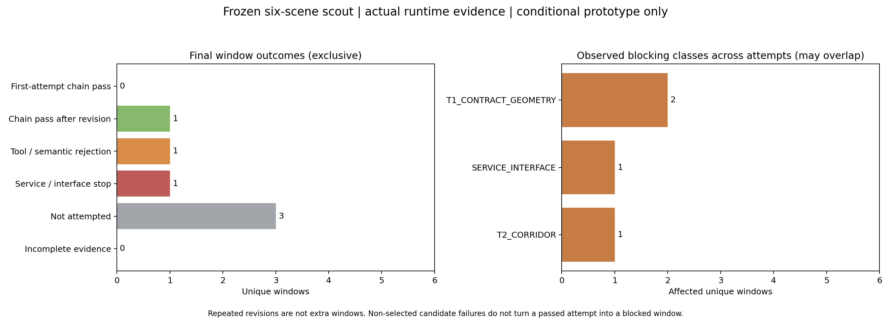
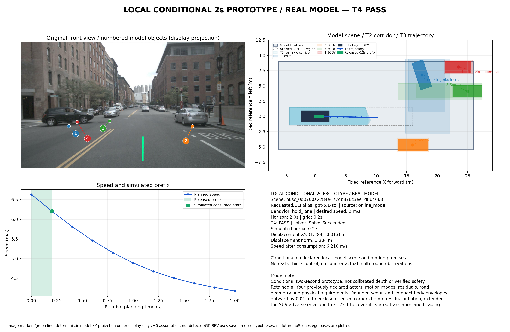

# 六场景摸底执行：服务停止后的部分结果

**按冻结计划实际执行，使用6/12次真实请求、得到5份合法原生JSON，涉及3个唯一窗口；另3窗未调用。新增1窗一次修订后的条件式全链通过，并实际模拟消费0.2秒移动前缀。** 第3窗修订发生服务连接错误，整批已停止；未继续消耗剩余6次，未调用两个预留验证窗。六窗未齐，本轮不修改冻结算法或预判两项方案改进。

|窗口|初答|唯一修订|最终结果/行为|
|---|---|---|---|
|0796 普通直行|原生JSON/T1通过；T2空或种子受阻|原生JSON/T1通过；T2空或初态不在走廊|无轨迹、无前缀；不是静止等待通过|
|0103 前车减速候选|原生JSON；T1 `BODY_ENVELOPE_CONFLICT`|**T1–T4、独立接受器、执行回执及积分通过**|MOVING_PREFIX，前向1.284m，末速6.210m/s；减速/保持车道方向基本合理|
|0553 信号等待候选|原生JSON；T1 `PREMISE_SCOPE`|连接服务错误，无原生JSON|无前缀；停车意图不能计作有效等待|
|0916 邻车/轻弯|NOT_ATTEMPTED|NOT_ATTEMPTED|未评价|
|1094 夜间行人|NOT_ATTEMPTED|NOT_ATTEMPTED|未评价|
|1077 夜间直行|NOT_ATTEMPTED|NOT_ATTEMPTED|未评价|

[完整逐窗表](summary/window_results.md)、[逐尝试/全部候选机器结果](summary/window_results.json)、[原始批次账本](batch_summary.json)。首次全链通过0窗、修订后通过1窗、正常工具拒绝1窗、服务停止1窗、未调用3窗。修订不增加独立窗口，未调用不算失败；不从该部分批次给出方案成功率结论。



右图按任意尝试中真正阻断链路的**唯一窗口**计数，可重叠。T1契约一致性2窗包含“车身包络”和“异步前提作用域”两种具体问题，不能把这个宽类别视为同一根因。成功尝试中被淘汰候选的失败不计作该窗口问题。服务中断导致后3窗未调用，图中仍只记实际发生服务错误的1窗，不把未调用画成算法失败。

## 新的真实模型条件式成功案例



输入为固定10张真实图像及采集/标定/自车状态。请求与CLI别名`gpt-6.1-sol`，实际服务端模型快照未暴露。模型修订自身包络后，现有T1、5候选T2、实际CasADi/IPOPT、连续车身T4及独立接受器通过。工具未补道路、删障碍、缩小残差或修改模型数值。

- 原生决策：`hold_lane`，期望速度2m/s、`stop=null`；两秒轨迹包含11个状态，选中候选`brake_straight`。
- 实际只模拟消费0.2秒：位置变化 **[1.284076, −0.012870]m**，速度 **6.630763→6.210393m/s**，偏航−0.006987rad；条件最小间距下界约 **1.4896m**，仍要求1m。
- 两秒计划末速约4.1776m/s、中心前向位置约10.1468m，均为未消费尾部，不能当作已执行结果。期望速度是偏好，不是瞬间达速要求。

关键证据：[修订原生JSON](runtime/following_deceleration/transport/attempt_02/native_output.json)、[完整模型记录](runtime/following_deceleration/attempt_02/record.json)、[T1](runtime/following_deceleration/attempt_02/T1.json)、[T2](runtime/following_deceleration/attempt_02/T2.json)、[T3](runtime/following_deceleration/attempt_02/T3.json)、[T4](runtime/following_deceleration/attempt_02/T4.json)、[执行回执](runtime/following_deceleration/attempt_02/execution_receipt.json)、[独立接受器](runtime/following_deceleration/attempt_02/acceptor.json)。

[独立行为审阅](behavior_review.md)确认原图左侧转出SUV与减速方向有依据、横移约1.29cm，没有大幅变道。但画面中央较远同向车没有独立模型ID，仅由局部前提处理远处车流；**本例不是完整跟车或停车让行验证**。图中投影采用展示用z=0前提，不是检测框或深度真值。结果只以模型局部域和运动条件成立为前提，不是真实车辆安全、G2通过或多轮反事实观测。

## 调用、服务与启动器记录

[执行登记](actual_activation.json)独立于[原准备计划](../six_scene_scout_preparation_20261029_v1/execution_plan.json)，未改写准备期`launched=false`。运行前核对6窗60图及23项源码/协议SHA，保持2秒/.2秒网格/.2秒前缀、原车辆/1.2m偏移/1米间距、提示`driving_prototype_v1`、3.0.0-exp2/wire v2及`bounded_seed_candidates_v1`。现有提示中的旧圆盘说明差异仍保留，未在批中修提示。

固定CLI0.164.0、现有ChatGPT登录及17891代理；API-key环境被适配器移除，没有换账号/模型或SSH转发。调用前唯一[额度元数据读取](quota_preflight/result.json)显示窗口使用24%、未标记耗尽，生成请求0；它不保证生成服务可用性。本批6份charge文件与6个`turn/start`逐项一致，5份原生输出均过原业务Schema，没有隐藏生成探测或自动重发。

第3窗修订错误为 `responseStreamDisconnected`、`Connection failed: error sending request`，HTTP状态未知，**不是已证实429或额度耗尽**。服务通知`willRetry=true`，适配器首次错误即终止app-server；未追加turn/start。内部HTTP重连次数不可见，不能声称为零。[原始失败](runtime/signal_wait/attempt_02/failure.json)及[净化RPC事件](runtime/signal_wait/transport/attempt_02/events.redacted.jsonl)保留；原台账SERVICE=NOT_REACHED不被追写，已收到错误通知与扣账另列。

启动器首窗记录结果时发生绝对/相对路径混用异常：[原控制台](batch_console.txt)。只修复启动器路径及已完成窗口的记账恢复，使用[恢复登记](resume_activation_01.json)沿用原截止与12次总预算；首窗2次请求和原失败未重跑、不重新扣账或清零，随后只启动后续窗口。此修复不是驾驶算法改动或效果收益。两版控制台、原启动器Git提交及[2项预算干跑](launcher_budget_dry_run.txt)/[2项路径与恢复干跑](launcher_recovery_dry_run.txt)均保留，人工干跑的模型调用为0。

算法/提示/Schema/物理源码仍为原准备基线`4336dca`的固定字节。启动器版本`a16e047`及修复`d519f07`/`bee7780`分别记录，实际每窗配置保存源码SHA。私有认证状态/raw仅在现场0700/0600目录，被Git排除；各窗口公有SHA清单不冒称包含私有内容。

[交付核对](delivery_validation.json)确认23项冻结源码/协议、130份窗口公有文件及全部5份原文/原生JSON/记录一致，运行capture只有预注册revision递增；6次扣账与6个turn/start吻合。[8项已有数据契约回归](dataset_contract_regression.txt)全部通过；四项预算/路径恢复干跑为人工软件检查，不计真实调用或在线分子。未因本轮增加无关的全量优化测试。

## 少量关键对象的独立离线检查

[三窗六个对象的完整表](offline_eval/README.md)保留中心、尺寸、可比yaw、全部情景未来覆盖与膨胀、缺失和未匹配。按每窗最后有效响应计，共21条声明对象，仅选择6槽关联；所选6槽均有位置/BODY/占用且合法匹配6，这不是全场景召回。五份响应中的重复对象行不当成独立对象。后3个未调用窗没有模型值，也没有读取它们GT。

|窗口/对象|中心差m|未来有向注释proxy覆盖 / 面积膨胀|
|---|---:|---|
|普通直行：蓝色后邻车 / 本车道后车|2.536 / 3.091|0.9836 / 5.694倍；1.0000 / 10.954倍|
|减速：黑SUV / 右侧停放车|0.144 / 0.231|1.0000 / 10.887倍；1.0000 / 2.677倍|
|信号窗：横向银车 / 左侧黑车|0.395 / 1.187|1.0000 / 13.856倍；1.0000 / 2.976倍|

身份按实际引用图像及官方SDK投影对应，非盲事后关联，不按最小误差找GT。固定BODY-box中心地面XY、采集参考时刻及原1.2m偏移；未来为原录像注释插值有向车身surrogate，非真实连续占用或执行新计划后的反事实响应。总残差只计一次、保留全部不利情景；高覆盖和宽包络不是可靠预测或安全证明。信号窗两行只是未获T1接受的原生参考状态假设对照，不以差值修复其前提/对齐拒绝。所有GT只在offline_eval，未反馈模型或工具。

## 两项修改与后续窗口

[当前决策](next_steps.json)：**六窗批次未完成，未按3窗数据选择或实施两项算法修改。** 已观察到T1契约一致性影响2窗、T2走廊1窗、服务1窗；后两类并列，而且服务错误阻止了余下3窗观察，尚不能代表六窗“前两类”。保持冻结，服务恢复后应先明确是否继续原先未调用的0916/1094/1077，保留同一分母及6次已消费账本，不重跑前3窗或换易例。

两个后续验证窗仍按原计划固定为0757 `e122a34e...`、1100 `8e5512a6...`，当前调用0、未启动，不用本批余额。本批补齐并据证据完成两项最小改动后，再按独立验证计划执行；规划器改动用相同原生JSON零调用旧/新比较，保留已有公交/停车场成功。不通过删除障碍、缩残差、降低间距或无理由静止来提高通过数。

## 零调用复现

已实际[离线回放](offline_replay_following/summary.json)复算成功窗，全链、接受器及模拟前缀通过，新增模型调用0。

```bash
cd /data2/hzy/MAP/agentic-driving
BASE=implementation/results/six_scene_scout_run_20261029_v1
OUT="$(mktemp -d /tmp/scout-following-replay.XXXXXX)/run"
OPENBLAS_NUM_THREADS=1 OMP_NUM_THREADS=1 \
  .venv/bin/python implementation/experiments/run_local_prototype.py \
  --capture implementation/results/six_scene_scout_preparation_20261029_v1/prepared_inputs/main/following_deceleration/capture.json \
  --wire implementation/results/exp2_wire_enum_day_pilot_20261028_v1/registration/wire_bundle \
  --replay "$BASE/runtime/following_deceleration/attempt_02/record.json" \
  --planner-profile bounded_seed_candidates_v1 --out "$OUT"
python implementation/experiments/prototype_figure.py --run "$OUT" --out "$OUT/result.png"
```

不要重跑真实启动器以重置本批预算。所有原准备、旧案例、失败与公有封存结果保留，未控制真实车辆。
