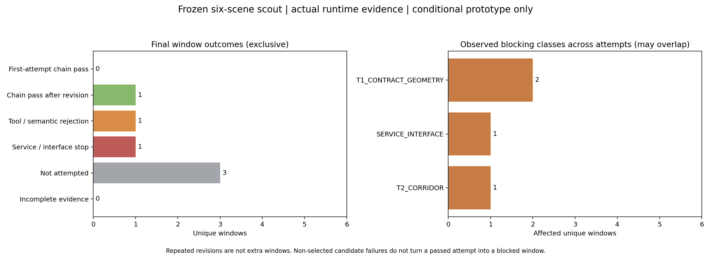

# 六场景真实运行结果

固定6个不同scene；已扣预算6/12；有原生合法输出的窗口3/6。没有合并修订或把未调用写作失败。

|窗口/scene|状态|原生有效/扣账|最深阻塞及服务|T2/T3/T4通过候选|前缀/位移m/末速m/s|条件间距m|行为合理性|
|---|---|---|---|---|---|---|---|
|普通直行 / scene-0796|TOOL_OR_SEMANTIC_FAILURE|2/2|T2 CORRIDOR_EMPTY,CORRIDOR_INITIAL_STATE|0/0/0|NOT_EXECUTED/—/—|—|待独立审阅|
|有同向前车的减速候选 / scene-0103|REVISION_PASS|2/2|—|2/2/2|MOVING_PREFIX/1.284/6.210|1.490|待独立审阅|
|信号等待候选 / scene-0553|SERVICE_INTERFACE_STOP|1/2|T1 PREMISE_SCOPE; SERVICE CODEX_SERVICE_FAILURE|NOT_REACHED|NOT_EXECUTED/—/—|—|待独立审阅|
|邻车与轻弯 / scene-0916|NOT_ATTEMPTED|0/0|—|NOT_REACHED|NOT_EXECUTED/—/—|—|待独立审阅|
|夜间行人交互 / scene-1094|NOT_ATTEMPTED|0/0|—|NOT_REACHED|NOT_EXECUTED/—/—|—|待独立审阅|
|夜间直行 / scene-1077|NOT_ATTEMPTED|0/0|—|NOT_REACHED|NOT_EXECUTED/—/—|—|待独立审阅|

左图为互斥最终状态，右图为各次尝试中真正阻断全链的问题类，按唯一窗口计数、可以重叠。未选中候选的失败保留在JSON，但不会把已通过尝试记成受阻。
服务通知、原文/业务Schema、完整5候选、首答/修订、接受器、模拟回执与积分状态均保留在window_results.json。原始SERVICE=NOT_REACHED不覆盖已经观察到的错误通知。
静止前缀不能自动算移动任务完成；信号等待标签也不是适用于自车的信号事实。行为合理性与离线GT均未由本脚本评分。
平顺性见JSON：最大加速度及离散jerk代理，后者不是分段常加速度控制的连续RMS jerk。

**批次未完成：只报告已观察问题，不据部分窗口选择或实施两项算法修改。**
