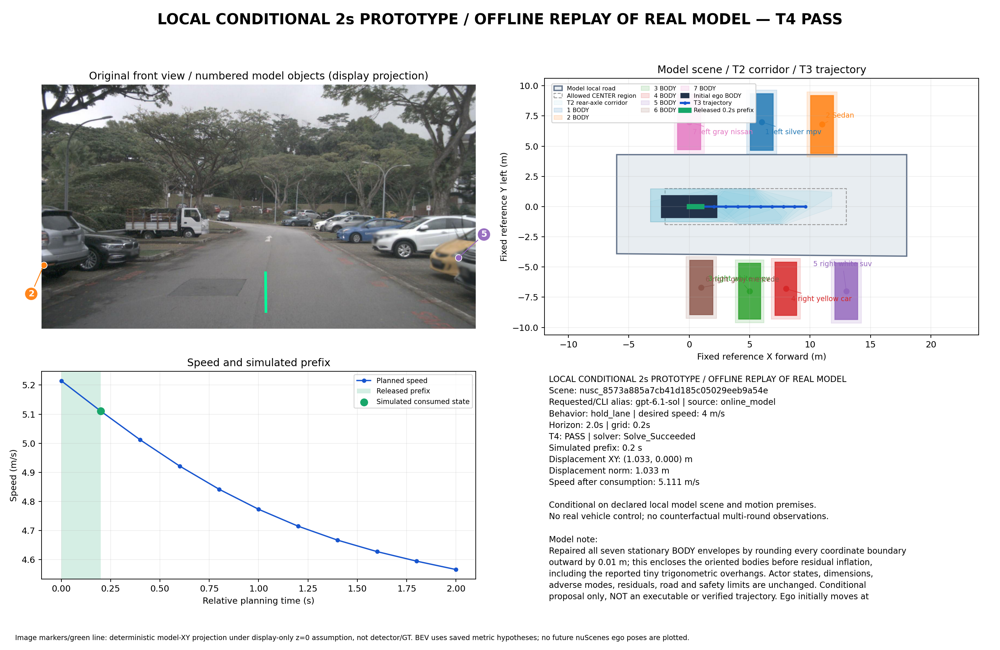

# T1–T4局部优化：固定真实输出的零调用对照

**完成最小代码改进和实际回放，新增真实调用0。固定记录的完整通过仍为3个窗口，未证明每一步或在线成功率提高。** 停车场恢复了一个原先数值求解失败的可行候选；普通直行消除了首格的占用提前扩张，但后续包络仍阻塞。未填模型数值、删障碍、缩残差或降低1米间距。

运行源码冻结于 **`16d63fb7d514a10cebe67ca7b4a62b8d3b99bc47`**；随后仅在`6c45fdd`补充接受器降级反例，运行算法不再改变。旧默认和v1保留，新改进显式选择 **`bounded_seed_candidates_v2`**。[实现说明与条件证明](../../docs/工具链局部优化v2.md)。原业务Schema、wire、提示词及5份摸底原生记录[逐字核对未变](input_preservation.json)；全部9份回放记录的输出摘要、采集摘要和7份可构造T1均[对照一致](comparison.json)。

| 环节 | 实际改动 | 验证结果与限度 |
|---|---|---|
| T1 | BODY冲突返回源、情景、外逸角点/距离；前提冲突返回声明/要求时间及冲突维度 | 减速初答外逸约3.29e−7m；信号初答前提[0,2]未覆盖所需[-.007605,0]。两份仍拒绝，不自动改朝向或延长前提 |
| T2 | 原生闭源按正长度交叠选择；保留完整多情景集合，用Decimal网格避免浮点假交叠。有限考察最近点及±X/±Y法向；原参考也用分段航向带 | 普通直行修订的原参考候选由[0,.2]失败推进至[1.2,1.4]仍失败。没有将它算作走廊通过 |
| T3 | 辅助变量K≥±κ，使用K·L²/8保守弦差界，替代零曲率附近病态的sqrt平滑式；保持单次IPOPT/700上限及所有硬约束 | 停车场同场景、同走廊、同种子：原700次迭代耗尽，新14次求解成功且原T4通过；无求解重试或硬约束放松 |
| T4/接受器 | 独立从原始trace验证，并与v2时间选择一致；沿用连续车身扫掠、原占用、全部情景和间距 | 新增边界时刻不利侵入仍拒绝，前缀0；轨迹篡改、v2降级v1均拒绝。未发现实际T4误拒，本轮未改连续扫掠余量 |

源时间选择消除的是**仅触边源提前扩张到整格**的保守性，不缩小任一模型源集合。它以T1已逐情景验证无正时间缺口、非零闭源完整覆盖为前提；T3约束每格两端，T4覆盖每个闭格及连续内部，边界仍检查。null、占位、正缺口及缺少不利分支继续拒绝。详情见上述数学说明和[覆盖反例](../../tests/test_native_cell_coverage.py)。

## 真实记录前后对照

以下是**6个唯一窗口的9份保存响应**，修订及施工两份输出不增加独立窗口。原生输出未转换，无新在线调用，不与旧在线成功结果混算。[机器对照](comparison.json)、[v1完整结果](baseline_final/summary.json)、[v2完整结果](improved_final/summary.json)保留全部候选和阶段。未到达均为NOT_REACHED。

| 保存响应 | v1 → v2：通过T2/T3/T4的候选数 | 全链/模拟前缀结果 |
|---|---|---|
| 公交路段 | 2/2/2 → 2/2/2 | 均通过；v2消费.2s，前向1.271865m，末速6.320778m/s |
| 停车场修订 | 4/1/1 → **4/2/2** | 均通过；消费.2s，前向1.032550m，末速5.110593m/s |
| 施工原记录 | 2/0/0 → 2/0/0 | 两个候选到T3仍Infeasible_Problem_Detected；无前缀 |
| 施工补历史记录 | 2/0/0 → 2/0/0 | 同上；有限走廊失败不能证明全局无解 |
| 普通直行初答 | 0/0/0 → 0/0/0 | 原[0,2]粗包络仍挡初态；无前缀 |
| 普通直行修订 | 0/0/0 → 0/0/0 | 原参考失败时间后移，但仍无完整T2；无前缀 |
| 减速初答 | T1拒绝 → T1拒绝 | 车身包络实际外逸；后续NOT_REACHED |
| 减速修订 | 2/2/2 → 2/2/2 | 均通过；v2消费.2s，前向1.284165m，末速6.210984m/s |
| 信号初答 | T1拒绝 → T1拒绝 | 异步运动前提作用域缺失；后续NOT_REACHED |

按这些保存响应逐阶段计数，两版均为T1=7、T2=5、T3=3、T4/接受器/消费=3。这不是数据集成功率。通过的3窗都为MOVING_PREFIX；v2条件间距下界分别约4.4611、2.2979、1.3936m，仍要求1m；最大绝对加速度约.3855、.5216、2.0989m/s²，未超过3m/s²制动上限。新候选/走廊变化使减速解略变，不将间距变化称为真实安全收益。



图示为保存的真实模型输出离线重规划，原图标记仅是展示用z=0投影。实际只消费.2秒，2秒尾部未执行；没有真实车辆控制、GT准确率评价或执行后新观测。原在线结果、人工多轮演示和本次离线结果分别保留。

## 测试与最具体的剩余问题

[395项完整回归](verification/unittest.txt)全部通过，0跳过，45.237s；网络连接被禁止，[来源](verification/provenance.json)对应冻结运行源码。之后仅增加接受器标识降级断言，[原3项定向测试重跑](final_targeted_tests.txt)全部通过，不另累加为398项。新增人工边界案例实际完成IPOPT→T4→模拟.2s消费→独立软件接受，但明确online=false，不计入真实窗口结果。

**最具体的剩余问题是普通直行修订的蓝色后邻车短时包络与可用道路/速度限制冲突。** 原参考候选[1.2,1.4]使用的不利BODY至X=12.1m；在12m/s限速下t=1.2最大自车后缘约12.096m，横向又受道路及残差限制。当前有限候选无可行走廊，不能通过移开蓝车或缩小残差解决。下一步应针对该对象请求有证据的更细短时包络，而非继续调IPOPT；本轮未发起该请求。施工尚不能排除其他走廊的可能，信号则必须由模型补齐对齐前提，均不伪造通过。

## 零调用复现

所有输出路径必须尚不存在。以下只读保存JSON，代码禁止网络连接；不使用任何旧预算：

```bash
cd /data2/hzy/MAP/agentic-driving
OUT="$(mktemp -d /tmp/toolchain-v2.XXXXXX)/run"
OPENBLAS_NUM_THREADS=1 OMP_NUM_THREADS=1 .venv/bin/python \
  implementation/experiments/compare_toolchain_replays.py \
  --profile bounded_seed_candidates_v2 --out "$OUT"
python implementation/experiments/prototype_figure.py \
  --run "$OUT/parking" --out "$OUT/parking.png"

TEST_OUT="$(mktemp -d /tmp/toolchain-tests.XXXXXX)/run"
.venv/bin/python implementation/experiments/run_metric_offline_tests.py --out "$TEST_OUT"
```

`baseline/`、`v2_first/`是源码冻结前开发回放，dirty事实保留；正式对照使用同一冻结运行源码的`baseline_final/`、`improved_final/`，source.json保留实际SHA。未启动后续模型请求或六窗补跑。
