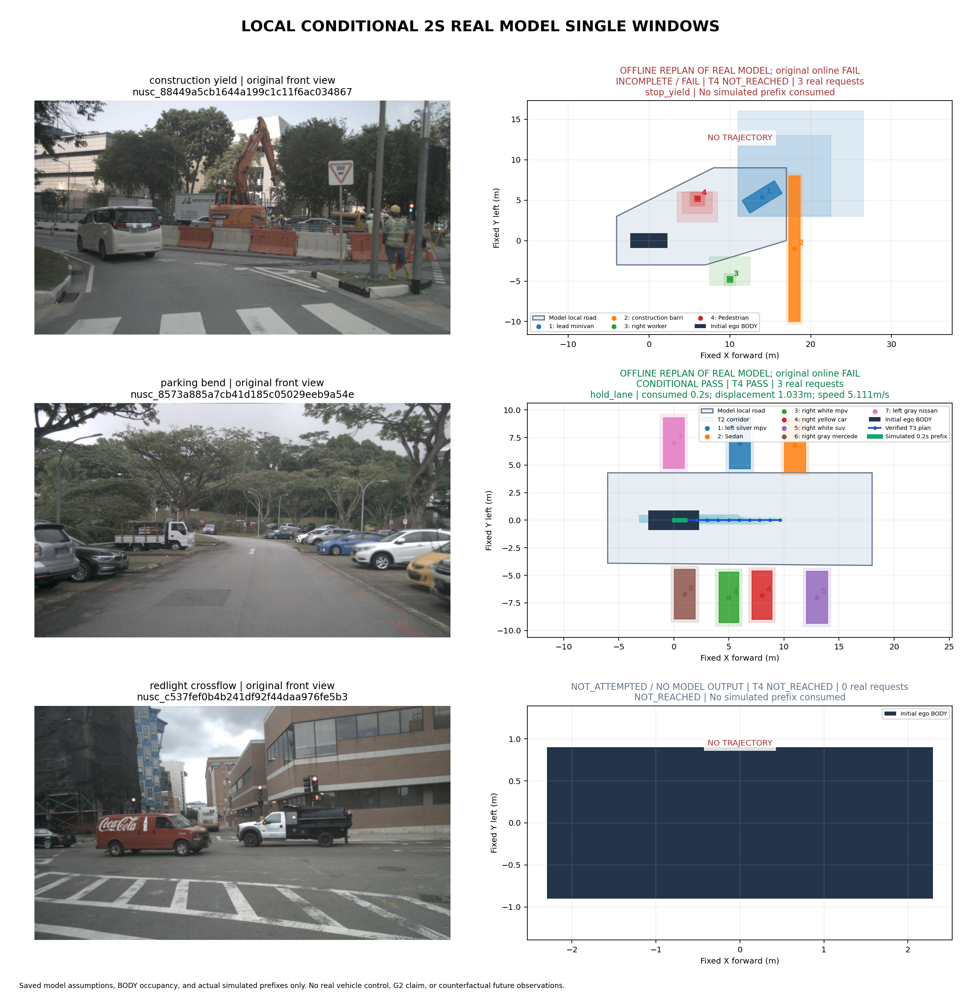

# 多场景2秒原型：新增案例与实际边界

**本轮用了6/8次真实生成请求后收到429，已停止；没有继续使用剩余2次。** 得到两组真实模型场景。原在线运行都未完成全链；随后保持模型输出、T1场景、车辆、1米安全间距和不确定范围不变，仅用显式新版车身规划/核验离线复算，停车场案例完成轨迹与0.2秒移动前缀消费。新增模型调用0。施工例仍失败，红灯例未调用，均不包装成成功。



| 场景 | 新真实请求 | 原在线结果 | 新版离线复算结果 |
|---|---:|---|---|
| 停车场邻车/缓弯入口，初速5.215m/s | 3（第三次429，无原生输出） | T1通过后T2拒绝近侧车辆 | **T1–T4、独立接受器通过；消费0.2秒，前进1.032550m，末速5.110593m/s** |
| 施工让行路口，初速4.981m/s | 3 | T1通过后T2空走廊 | 仍为T2空走廊，无轨迹/前缀 |
| 红灯横向车流，自车静止 | 0 | **NOT_ATTEMPTED**：前例429后停止 | 仅输入预览，不能当模型结果或静止安全通过 |

三窗分别为`8573a885a7cb41d185c05029eeb9a54e`、`88449a5cb1644a199c1c11f6ac034867`、`c537fef0b4b241df92f44daa976fe5b3`。后两窗图像历史已暴露，本次另列2秒原型，不追写旧5秒结论。均使用10张真实原图及采集/标定/自车数据；仅采集五表，无GT、地图或额外感知模型。

## 可查看的具体案例

- **停车场新结果**：[四面板大图](parking_bend/result.png)、[真实模型原记录](parking_bend/runtime/attempt_02/record.json)、[原在线失败](parking_bend/runtime/summary.json)、[离线全链结果](parking_bend/yaw_box_replay/round_result.json)、[独立核验](parking_bend/yaw_box_replay/attempt_01/T4.json)、[执行回执](parking_bend/yaw_box_replay/attempt_01/execution_receipt.json)。保留7辆声明对象及全部条件情景。2秒计划末位置约9.631m、末速4.566m/s；实际只消费0.2秒。短程轨迹近似直行，不称完成整个弯道。
- **施工失败**：[结果图](construction_yield/result.png)、[原在线三次记录](construction_yield/runtime/summary.json)、[第三份原生输出的新profile复算](construction_yield/yaw_box_replay/summary.json)，在[0.2,0.4]s空走廊；[第二份输出复算](construction_yield/yaw_box_replay_attempt2/summary.json)也在[0,0.2]s失败。没有删障碍、扩路或缩小不确定性求通过。T3/T4/消费均NOT_REACHED，不能据此证明所有轨迹全局无解。
- **未运行红灯例**：[原始输入](redlight_crossflow/capture.json)、[未调用原因](redlight_crossflow/not_attempted.json)。原图仅用于展示场景差异，未产生模型驾驶决策。

此前[公交路段在线单窗口成功](../moving_prototype_2s_20261028_v1/README.md)独立保留；它与本轮停车场离线重规划、施工失败、未调用窗口分别标注，不合并成成功率或人工多轮演示。

## 为何停车场需要不同的规划包络

原T2与原T4均用约3.614m的后轴外接圆。冻结停车场场景里，右侧车辆占用至真实自车矩形的距离约3.25m，扣模型总残差0.9m后仍约2.35m，大于原1m间距；外接圆却拒绝初态。这里有明确的配置空间保守性，不能靠模型移动车辆位置或扩大路面修复。

新增**显式可选**`yaw_bounded_box_v1`，旧默认圆盘和两份旧Schema保持不变：

- T2用完整车身在航向±0.35rad内的解析方向支持函数收缩道路及障碍半平面，CENTER区域单独处理后轴偏移；目标BODY、总残差和安全间距各计一次。
- T3仍为现有CasADi/IPOPT自行车模型，并新增相同航向硬界，未放松速度、加速度、转向、曲率或碰撞约束。
- T4显式采用`continuous_oriented_body_v1`，从原场景独立检查。每段完整车身端点凸包加`(1+r|κ|)L/2`余量保守包含采样间车身运动；继续检查初态、动力学、道路、全部占用、停车截止和航向界。不是仅检查离散点，也不是直接沿用旧圆盘PASS。
- 使用新增[走廊Schema](../../schemas/corridor_yaw_box_v1.schema.json)、[轨迹Schema](../../schemas/trajectory_yaw_box_v1.schema.json)，不静默混用。接受器重建走廊、重算独立T4并核对前缀积分。

停车场新T1与原在线T1逐值相同；模型位置、尺寸、道路、占用、前提和残差没有转换。原在线结果仍FAIL，新结果明确为**真实模型输出的离线重规划**，不是重新进行了在线闭环。它仍只在模型声明的局部域和短时运动条件下成立，不是G2、真实车辆安全或反事实多轮观测结论。

## 预算、测试与复现

[预先分配](plan.json)为3/3/2次、最大并发2例；[实际账本汇总](batch_result.json)记录6次扣账、剩余2次。收到的原错误含`429 Too Many Requests`及`exceeded retry limit`；客户端配置请求/流重试0、`willRetry=false`，内部HTTP尝试数未暴露，不能补造。5份有效原生输出与一次服务失败分别保留。所有后续重规划/绘图均0真实调用，没有绕过限流重发。

[原350项回归](offline_tests.txt)通过；新增车身分支后[360项完整回归](box_profile_tests.txt)通过，随后额外航向检查的[11项定向回归](box_final_targeted_tests.txt)通过，不把重复检查相加为独立测试。覆盖连续角点包络、转向角点/采样间碰撞、未来侵入静止车、profile隔离及旧圆盘行为。在线源码为`5e98614`；新离线planner源码为`2883d4a`。

以下复现停车场完整新profile链路，**不调用模型**，输出为新目录：

```bash
cd /data2/hzy/MAP/agentic-driving
BASE=implementation/results/varied_prototypes_2s_20261028_v1
OUT="$(mktemp -d /tmp/parking-body-replay.XXXXXX)/run"
.venv/bin/python implementation/experiments/run_local_prototype.py \
  --capture "$BASE/parking_bend/capture.json" \
  --wire implementation/results/exp2_wire_enum_day_pilot_20261028_v1/registration/wire_bundle \
  --replay "$BASE/parking_bend/runtime/attempt_02/record.json" \
  --planner-profile yaw_bounded_box_v1 --out "$OUT"
python implementation/experiments/prototype_figure.py --run "$OUT" --out "$OUT/result.png"
```

本轮结束。最具体的未解决项是施工路口当前声明场景在T2仍无非空走廊；红灯新增调用另受429阻塞。未追加真实请求，也未执行真实车辆控制。
